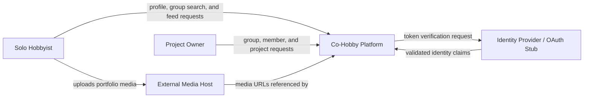

## 3 System vision

> For solo hobbyists and group creators who need dependable partner discovery and project follow-through, **Co-Hobby** provides skill profiles, category-and-role group filtering, and milestone-driven project tracking. The first release supports web users and exposes an OpenAPI contract for implementation and testing.

---

## 4 System boundary

### Inside software responsibility
- Hobby category and skill role catalogue (`/tags`);
- Hobbyist profiles and portfolio URL references (`/profiles`);
- Group creation, search, and member assignment (`/groups`);
- Project milestones and the public completed-project feed (`/projects`, `/feed/projects`).

### Outside or deferred
- Identity-token issuance by an external provider;
- Raw media hosting by external media services;
- Chat, notifications, payments, swipe matching, and administration panels.

### System context diagram

### Constraints and operational assumptions

- **Interface:** Requests and responses use JSON. Validation and domain errors use `application/problem+json`. Local development uses HTTP; deployed environments require HTTPS.
- **Security:** `GET /tags`, `GET /groups`, and `GET /feed/projects` are public. Write operations require a Bearer JWT, and restricted mutations require the group's `OWNER`.
- **Domain:** Stages advance only as `PLANNING → WEEK_1 → WEEK_2 → COMPLETED`; only completed projects can be shared.