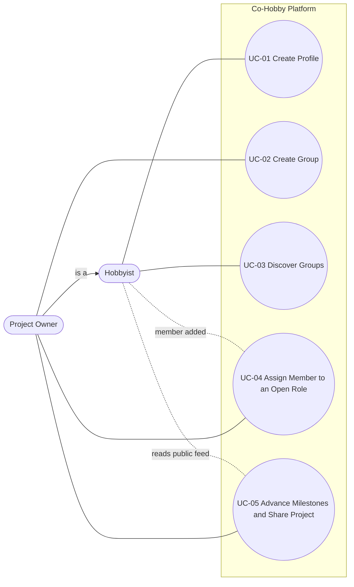

# Software Requirements Specification (SRS)

**Course:** SENG 321 Software Engineering
**Team:** 19
**Project:** Co-Hobby
**Sprint:** 2
**Status:** Ready for review — authored by @beyazitKRGL (Issue #26)

## 1. Introduction

### 1.1 Purpose

This document specifies the functional, data and interface requirements of Co-Hobby's first release. It is written for the implementation team in Sprint 3 and later, for peer reviewers who must be able to implement the system from it, and for evaluators who check traceability from user story to API operation.

### 1.2 Scope

Co-Hobby is a web platform where hobbyists build skill profiles, find open groups by hobby category and needed skill role, and then track and share the projects their groups complete. The scope is identical to the first-release scope in `docs/01-project-proposal.md`; this document refines it and does not expand it.

**Intended outcome:** a registered hobbyist can filter open groups by category and needed role and be added to a compatible group in less than three minutes during a usability test; after a group is formed, the Project Owner can track the project through sequential milestones and publish it to the public feed.

**Included in the first release (US-01 to US-07)**

- Predefined hobby categories and skill roles.
- Hobbyist profiles with external media URLs.
- Group creation and category/role search.
- Owner-controlled assignment to open skill roles.
- Sequential project milestones (PLANNING → WEEK_1 → WEEK_2 → COMPLETED).
- Completed-project sharing and a public feed.

**Deferred (outside the first release)**

- Real-time chat; swipe-based matching; voice and video calls.
- Payments, selling services and advertising.
- Automated email or push notifications; live GPS tracking.
- Administration and moderation panels.
- Raw media hosting (media stays on external hosts).
- Implementation of an identity provider.

### 1.3 Definitions and Abbreviations

| Term | Definition |
|---|---|
| Hobbyist | Registered user with a hobbyist profile |
| Project Owner | Group creator; holds the OWNER member role |
| Milestone | Project stage: PLANNING → WEEK_1 → WEEK_2 → COMPLETED |
| Category | A predefined hobby category (e.g. Music) returned by `getTags` |
| Skill Role | A predefined role within a category (e.g. Guitarist, Drummer, Vocalist) |
| Open Role | A needed skill role of a group that has no member assigned yet |
| Public Feed | List of completed projects that were shared by their Project Owner |
| JWT | JSON Web Token sent as a Bearer token to authenticate API requests |
| Identity Provider / OAuth stub | External service that issues identity tokens; a documented local JWT stub with the same API boundary is used in development |

### 1.4 References

- Sprint 2 assignment text (Teams submission)
- `docs/01-project-proposal.md` — problem, stakeholders, scope
- `docs/02-vision-and-boundary.md` — vision, boundary, constraints
- `docs/05-product-backlog.md` — user stories and acceptance criteria
- `api/openapi.yaml` — API contract (source of truth for interfaces)
- Course slides: Requirements Engineering; OOAD & UML; Software Architecture

### 1.5 Document Conventions

- Requirements are numbered sentences with unique IDs: `FR-<epic>.<number>`. Each requirement maps to one user story (`US-xx`), one or more use cases (`UC-xx`) and API operations (by operationId).
- "Shall" marks a mandatory requirement. Nothing in this document is optional for the first release.
- In use cases, the main flow is numbered 1, 2, 3...; error flows are `E1, E2...` and alternative flows are `A1, A2...`, each with its HTTP status where the API defines one.
- Use cases follow the scenario structure of the course slides: starting situation (preconditions), normal flow of events, what can go wrong (alternate/error flows) and the state when the scenario finishes (postconditions).
- Key terms and field names are written in `code font`.

## 2. Overall Description

**User classes**

- **Solo Hobbyist:** a registered user looking for a group for a hobby. Can create a profile, search groups and view the public feed. Reading categories, searching groups and browsing the feed are public and do not require login.
- **Project Owner:** a Hobbyist who created a group. Additionally can assign members, create the project, advance milestones and share the completed project.

**External systems**

- **Identity Provider / OAuth stub:** issues the identity tokens that the system verifies. Its implementation is outside the system.
- **External media hosts:** host portfolio media that profiles reference by URL. The system stores URLs only.

**Operating environment:** the first release supports web users. The system is a web API (`api/openapi.yaml`, version 0.1.0) served under the `/api/v1` base path, over HTTP locally and HTTPS when deployed.

**Constraints**

- Requests and responses use JSON. Validation and domain errors use `application/problem+json` (the `Problem` schema).
- `GET /tags`, `GET /groups` and `GET /feed/projects` are public; all other operations require a Bearer JWT.
- Mutations on a group or project (adding members, creating a project, advancing progress, sharing) are restricted to the OWNER and return 403 otherwise.
- Project stages advance sequentially only; only completed projects can be shared.
- No feature beyond US-01 to US-07.

**Assumptions** (from `docs/01`)

- Users provide accurate profile and skill information; required fields and predefined tags support this.
- Owners and hobbyists agree on initial join interest outside the platform before an owner adds a member.
- Users can provide external URLs for portfolio media.

**Risks** (from `docs/01`)

- A user is added twice or assigned to a role that is already filled → the system returns 409.
- An owner skips project stages or shares an unfinished project → the system enforces sequential transitions and returns 409.
- The identity provider is unavailable during development → a local JWT stub with the same API boundary is used.
- Public pages (groups, feed) may show fake or inappropriate content because moderation tools are deferred → every write requires authentication and only completed projects can be shared.
- The scope grows beyond what the team can deliver in the sprint schedule → the deferred list stays explicit.

## 3. Functional Requirements

Each requirement maps to exactly one user story. No scope is added beyond the seven stories. Acceptance criteria follow `docs/05-product-backlog.md`; where the API contract adds detail (for example 403 or 404 responses), the contract is followed.

### 3.1 Epic 1 — Hobbyist Identity

**Rationale:** owners can only judge a candidate if the profile states a category and a skill role; predefined tags keep profiles comparable and searchable.

| ID | Requirement | User Story | Acceptance Criteria |
|---|---|---|---|
| FR-1.1 | The system shall provide predefined hobby categories and skill roles. | US-01 | `GET /tags` returns an array of categories, each with its roles, with 200 and without authentication. |
| FR-1.2 | The system shall allow a registered user to create a hobbyist profile. | US-01 | A request with `displayName`, `primaryCategory` and `skillRole` (and optional `bio`, `mediaUrls`) returns 201 with the profile; a missing required field or an invalid media URL returns 400; a missing or invalid token returns 401. |

### 3.2 Epic 2 — Group Formation

**Rationale:** general-purpose channels cannot filter by category and needed role or show open vacancies (see `docs/01`, problem statement); explicit open roles and owner-controlled assignment make vacancies clear and prevent double assignment.

| ID | Requirement | User Story | Acceptance Criteria |
|---|---|---|---|
| FR-2.1 | The system shall allow a creator to create a group with open roles. | US-02 | A request with `groupName`, `category`, `creatorSkillRole` and at least one entry in `neededRoles` returns 201 and the creator is the OWNER; a missing field or empty `neededRoles` returns 400; no token returns 401. |
| FR-2.2 | The system shall allow searching groups by category and role. | US-03 | `GET /groups` with the required `category` and optional `seekingRole` returns 200 with the matching open groups, or an empty list when none match, without authentication; a missing `category` returns 400. |
| FR-2.3 | The system shall allow the Project Owner to assign a member to an open role. | US-04 | The OWNER submits `userId` and `skillRole` and receives 200 with the updated group, in which the user is a MEMBER; a non-owner gets 403; an unknown group or user gets 404; a duplicate member or a filled role gets 409 (ROLE_SLOT_FULL). |

### 3.3 Epic 3 — Project Execution and Showcase

**Rationale:** informal groups lose momentum without progress tracking and finished work is hard to showcase; sequential milestones and a public feed address both.

| ID | Requirement | User Story | Acceptance Criteria |
|---|---|---|---|
| FR-3.1 | The system shall allow the Project Owner to initialize a project in PLANNING. | US-05 | The OWNER submits `groupId` and `title` and receives 201 with `progressStage` PLANNING and `isShared` false; a non-owner gets 403; an unknown group gets 404. |
| FR-3.2 | The system shall allow sequential milestone advancement only. | US-06 | The OWNER submits the next `progressStage` and receives 200; skipping a stage or moving backward returns 409; a non-owner gets 403; an unknown project gets 404. |
| FR-3.3 | The system shall allow sharing completed projects to a public feed. | US-07 | The OWNER can share a COMPLETED project and receives 200 with `isShared` true; sharing a project that is not COMPLETED returns 409; `GET /feed/projects` returns the shared projects with 200 without authentication. |

## 4. Use Cases

**Use case model**

Each use case below lists its actors, preconditions, main flow, alternate/error flows and postconditions.

### UC-01 Create Profile (US-01)

- **Primary actor:** Hobbyist (registered user)
- **Preconditions:**
  - User has a valid Bearer JWT (needed for profile creation, not for viewing categories).
- **Main flow:**
  1. User requests the predefined hobby categories and skill roles.
  2. System returns the list of categories with their roles.
  3. User submits displayName, primaryCategory and skillRole, and optionally a bio and media URLs.
  4. System authenticates the token.
  5. System validates the request body.
  6. System stores the profile.
  7. System returns 201 with the created profile.
- **Alternate/error flows:**
  - E1: Missing or invalid authentication → 401.
  - E2: Invalid or incomplete body (e.g. a required field is missing or a media URL is not a valid URI) → 400.
- **Postconditions:** A hobbyist profile exists for the user.

### UC-02 Create Group (US-02)

- **Primary actor:** Hobbyist (becomes Project Owner)
- **Preconditions:**
  - User has a valid Bearer JWT.
- **Main flow:**
  1. User submits groupName, category, creatorSkillRole and neededRoles, and optionally a description.
  2. System authenticates the token.
  3. System validates the body, including at least one needed role.
  4. System creates the group and assigns the creator the OWNER member role with the creator's skill role.
  5. System returns 201 with the group listing.
- **Alternate/error flows:**
  - E1: Missing or invalid authentication → 401.
  - E2: Invalid body, such as a missing required field or an empty neededRoles list → 400.
- **Postconditions:** A group with open roles exists and the creator is its OWNER.

### UC-03 Discover Groups (US-03)

- **Primary actor:** Hobbyist (login is not required)
- **Preconditions:** None.
- **Main flow:**
  1. User selects a category and, optionally, the skill role they are looking for.
  2. System validates the query.
  3. System returns the open groups that match.
  4. User views a group listing and its open roles.
- **Alternate/error flows:**
  - E1: Missing or invalid query parameter (e.g. no category) → 400.
  - A1: No group matches → system returns 200 with an empty list.
- **Postconditions:** None; no data is changed.

### UC-04 Assign Member to an Open Role (US-04)

- **Primary actor:** Project Owner
- **Secondary actor:** Hobbyist (member being added)
- **Preconditions:**
  - Owner has a valid Bearer JWT.
  - Target group exists.
  - The requested skill role still has an open vacancy.
- **Main flow:**
  1. Owner submits userId and skillRole for the group.
  2. System authenticates the token.
  3. System verifies the requester is the group's OWNER.
  4. System verifies the group exists and the role is still open.
  5. System adds the user as MEMBER with the requested skillRole.
  6. System returns 200 with the updated group listing.
- **Alternate/error flows:**
  - E1: Missing or invalid authentication → 401.
  - E2: Requester is not OWNER → 403.
  - E3: Unknown group or user ID → 404.
  - E4: Duplicate member or role already filled → 409 (ROLE_SLOT_FULL).
  - E5: Invalid or incomplete request body (e.g. userId or skillRole is missing) → 400.
- **Postconditions:** Role vacancy is filled; group contains the new MEMBER.

### UC-05 Advance Milestones and Share Project (US-05, US-06, US-07)

- **Primary actor:** Project Owner
- **Secondary actor:** Hobbyist (reads the public feed)
- **Preconditions:**
  - Owner has a valid Bearer JWT.
  - The group exists and the requester is its OWNER.
- **Main flow:**
  1. Owner creates a project with the group's ID and a title; the system creates it in stage PLANNING with isShared false and returns 201 (US-05).
  2. Owner advances the project to WEEK_1; the system validates the order and returns 200 (US-06).
  3. Owner advances the project to WEEK_2; the system returns 200.
  4. Owner advances the project to COMPLETED; the system returns 200.
  5. Owner shares the completed project; the system publishes it, sets isShared to true and returns 200 (US-07).
  6. Any user can see the project in the public feed (`getSharedProjectsFeed`), without login.
- **Alternate/error flows:**
  - E1: Missing or invalid authentication → 401.
  - E2: Requester is not OWNER → 403.
  - E3: Unknown group (on create) or unknown project (on progress or share) → 404.
  - E4: Invalid body (e.g. missing title, or an unknown stage value) → 400 on `createProject` and `updateProjectProgress`.
  - E5: Stage skipped or moved backward → 409 on `updateProjectProgress`.
  - E6: Project is not COMPLETED → 409 on `shareProject`.
- **Postconditions:** The project is in its new stage; after step 5 it appears in the public feed.

## 5. Data Requirements

Every entity below matches the component schemas in `api/openapi.yaml`.

| Entity (schema) | Fields and rules |
|---|---|
| TagCategory | `category` (string, required), `roles` (array of string, required). Returned by `getTags`. |
| NewProfile | `displayName` (string, required), `primaryCategory` (string, required), `skillRole` (string, required), `bio` (string, optional), `mediaUrls` (array of string in URI format, optional). |
| ProfileResponse | NewProfile fields plus `id` (UUID, required) and `userId` (UUID, required). |
| NewGroupListing | `groupName` (string, required), `category` (string, required), `creatorSkillRole` (string, required), `neededRoles` (array of string, `minItems` 1, required), `description` (string, optional). |
| GroupMember | `userId` (UUID), `memberRole` (enum OWNER, MEMBER), `skillRole` (string); all required. `memberRole` is distinct from `skillRole`. |
| AddMemberRequest | `userId` (UUID, required), `skillRole` (string, required). |
| GroupListingResponse | NewGroupListing fields plus `id` (UUID, required) and `members` (array of GroupMember, required). |
| NewProject | `groupId` (UUID, required), `title` (string, required), `description` (string, optional). |
| ProgressUpdateRequest | `progressStage` (enum PLANNING, WEEK_1, WEEK_2, COMPLETED, required). |
| ProjectResponse | NewProject fields plus `id` (UUID, required), `progressStage` (enum PLANNING, WEEK_1, WEEK_2, COMPLETED, required) and `isShared` (boolean, required). |
| Problem | `title` (string, required), `status` (integer, required), `code` (string, required), `detail` (string, optional). Sent as `application/problem+json`. |

**General field rules:** identifiers are UUIDs, media URLs use URI format, required fields are enforced by the schema, and `neededRoles` must contain at least one role.

## 6. Interface Requirements

Every endpoint is listed with its operationId and its representative success and error responses. The contract in `api/openapi.yaml` is authoritative. All paths are relative to the `/api/v1` base path. `getTags`, `listAvailableGroups` and `getSharedProjectsFeed` are public; all other operations require a Bearer JWT.

| Path | OperationId | Method | Success | Errors |
|---|---|---|---|---|
| `/tags` | getTags | GET | 200 | 400 |
| `/profiles` | createProfile | POST | 201 | 400, 401 |
| `/groups` | listAvailableGroups | GET | 200 | 400 |
| `/groups` | createGroup | POST | 201 | 400, 401 |
| `/groups/{groupId}/members` | addGroupMember | POST | 200 | 400, 401, 403, 404, 409 |
| `/projects` | createProject | POST | 201 | 400, 401, 403, 404 |
| `/projects/{projectId}/progress` | updateProjectProgress | PATCH | 200 | 400, 401, 403, 404, 409 |
| `/projects/{projectId}/share` | shareProject | POST | 200 | 401, 403, 404, 409 |
| `/feed/projects` | getSharedProjectsFeed | GET | 200 | 400 |

**Representative responses**

- **Success (200 or 201):** the created or updated resource as a `ProfileResponse`, `GroupListingResponse` or `ProjectResponse`; `getTags` returns an array of `TagCategory`.
- **400:** a `Problem` with code `INVALID_INPUT`, e.g. detail "Required field skillRole is missing."
- **409 on `addGroupMember`:** a `Problem` with title "Role Vacancy Full" and code `ROLE_SLOT_FULL`, e.g. "The Drummer vacancy has already been filled."

## 7. Non-Functional Requirements

See `docs/07-nfr-quality-measures.md`.

## 8. Requirements Traceability Matrix

Each row traces a functional requirement to its user story, use case and API operation. Operation names come from `api/openapi.yaml`.

| FR | User Story | Use Case | API Operation(s) |
|---|---|---|---|
| FR-1.1, FR-1.2 | US-01 | UC-01 | getTags, createProfile |
| FR-2.1 | US-02 | UC-02 | createGroup |
| FR-2.2 | US-03 | UC-03 | listAvailableGroups |
| FR-2.3 | US-04 | UC-04 | addGroupMember |
| FR-3.1 | US-05 | UC-05 | createProject |
| FR-3.2 | US-06 | UC-05 | updateProjectProgress |
| FR-3.3 | US-07 | UC-05 | shareProject, getSharedProjectsFeed |
