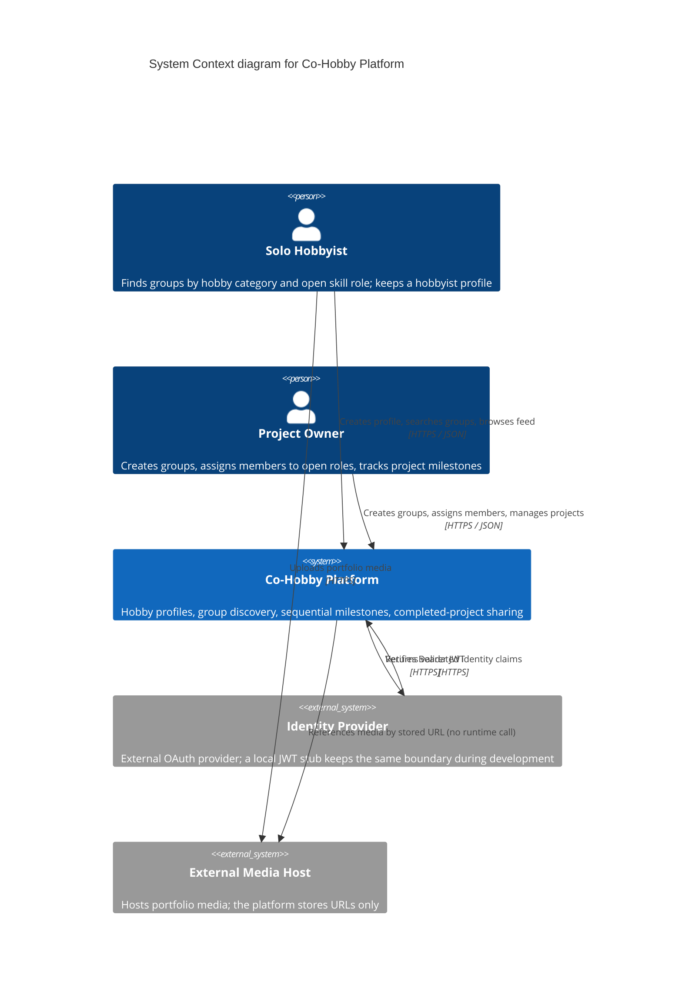

# Software Architecture Documentation

**Course:** SENG 321 Software Engineering
**Team:** 19
**Project:** Co-Hobby
**Sprint:** 2
**Status:** Draft — skeleton prepared by @Bruhun, authored by @Bruhun (Issue #32) and @bakicanerdogan (Issue #34)

> Document the architecture using C4 models and UML diagrams.
> Diagram sources live in this file and in `docs/diagrams/`; commit PNG exports alongside them
> so diagrams survive independently of any external tool or link.
> C4 Level 1 below is already drawn and must stay consistent with `docs/02-vision-and-boundary.md`.

## 1. Purpose and Scope

<TODO: which architecture decisions this document records and how it relates to the SRS
(`docs/06-srs.md`) and the NFR document (`docs/07-nfr-quality-measures.md`).>

## 2. Architecture Overview

<TODO: one paragraph — layered monolith, Spring Boot REST backend, web frontend, external
identity provider (documented stub), database, external media references by URL. No raw media
hosting; no chat/payments/notifications in the first release.>

## 3. C4 Model

### 3.1 Level 1 — System Context (Issue #32) ✅

> The Co-Hobby Platform as a single system, its users, and its external systems.
> Person/System/External-System mapping follows the C4 model.
> Consistent with `docs/02-vision-and-boundary.md`: no new actors or systems were added.

**Relationship notes (read with the diagram):**

- The media host has **no runtime integration** with Co-Hobby: the platform only stores user-provided URLs in profiles; nothing flows from the host into the system. The arrow direction here deliberately corrects the Sprint 1 sketch, which drew this relationship as `Media → System`.
- **Platform Administrators are omitted on purpose** — the first release has no moderation or administration features (deferred in `docs/01-project-proposal.md`).
- Local development uses HTTP; deployed environments require HTTPS (`docs/02-vision-and-boundary.md`).

**Element shapes:** stick figures = people (actors), blue-grey box = Co-Hobby itself, lighter boxes = external systems. Arrows show the direction a request or data reference flows.

> If the C4Context block does not render in your viewer, use the standalone Mermaid source in
> [`docs/diagrams/c4-context.md`](../diagrams/c4-context.md) or the PNG export
> `docs/diagrams/c4-context.png` (generate it with <https://mermaid.live>; commit it together with
> the Issue #32 content work).

### 3.2 Level 2 — Containers (Issue #32)

<TODO: zoom into Co-Hobby: web frontend, Spring Boot REST API, relational database,
external identity provider (stub), external media host. Show protocol links (HTTP/REST, JSON,
JDBC) and responsibilities. Draw as Mermaid C4Container or a labelled flowchart and commit a PNG.>

### 3.3 Level 3 — Components (optional)

<TODO: only include if the assessment checklist explicitly requires it. Otherwise, mark the
section as intentionally omitted.>

## 4. Design Decisions

> 2–4 short decisions with rationale and consequences. Each decision should reference the NFRs
> that drove it.

### DD-01 Layered Monolith

<TODO: single deployable Spring Boot service with controller/service/repository layers.
Rationale: class-scale scope, team size, simple deployment, testability. Consequences: simpler
first release, limited horizontal scaling, bounded change scope. Reference the relevant NFRs.>

### DD-02 OpenAPI-First Contract

<TODO: `api/openapi.yaml` is the implementation contract. Rationale: parallel frontend/backend
work, testable API boundary, existing CI lint. Consequences: schema changes must go through PR
review; client/server can be generated. Reference NFR-M-01.>

### DD-03 Authentication Boundary (External IdP with Local Stub)

<TODO: Bearer JWT validation at the API boundary; no in-house identity provider. Rationale:
first-release scope, identity provider availability risk documented in Sprint 1. Consequences:
same API interface in tests and production; stub must not leak identity logic into domain.
Reference NFR-S-01, NFR-S-02, and the Sprint 1 boundary.>

### DD-04 Data Storage

<TODO: relational database choice (e.g., PostgreSQL) for profiles, groups, members, projects,
tags. Rationale: structured domain, referential integrity (member-role, milestone state),
ACID guarantees for conflict cases (409). Consequences: migrations, schema versioning.
Reference NFR-R-01.>

## 5. UML Diagrams

- Use-case diagram and milestone state diagram: `docs/diagrams/` (Issue #33, @Bruhun)
- Domain class diagram and API sequence diagrams: `docs/diagrams/` (Issue #34, @bakicanerdogan)

> Diagrams are committed as Mermaid sources and PNG exports and are cross-referenced from
> `docs/06-srs.md` use cases.

## 6. Consistency with Sprint 1 Boundary

- C4 Level 1 must not add actors, external systems, or responsibilities missing from `docs/02-vision-and-boundary.md`.
- The API still follows `api/openapi.yaml`; if a requirement forces a contract change, update
  the contract in the same PR.
- Deferred items stay out: chat, payments, notifications, swipe matching, raw media hosting,
  administration panels, identity-provider implementation.
