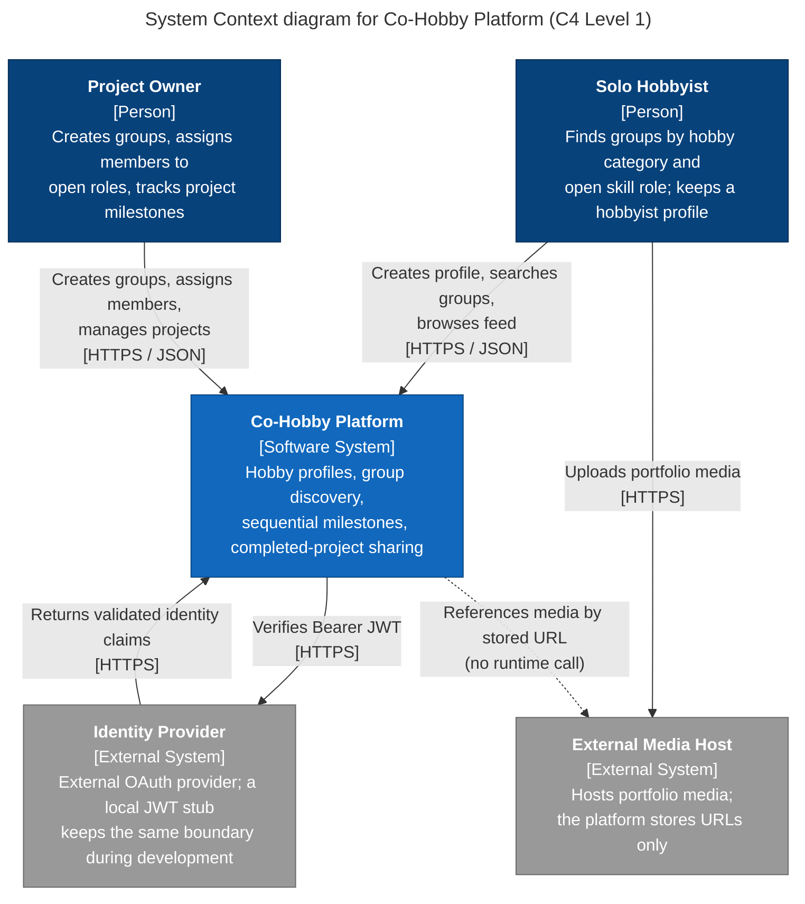
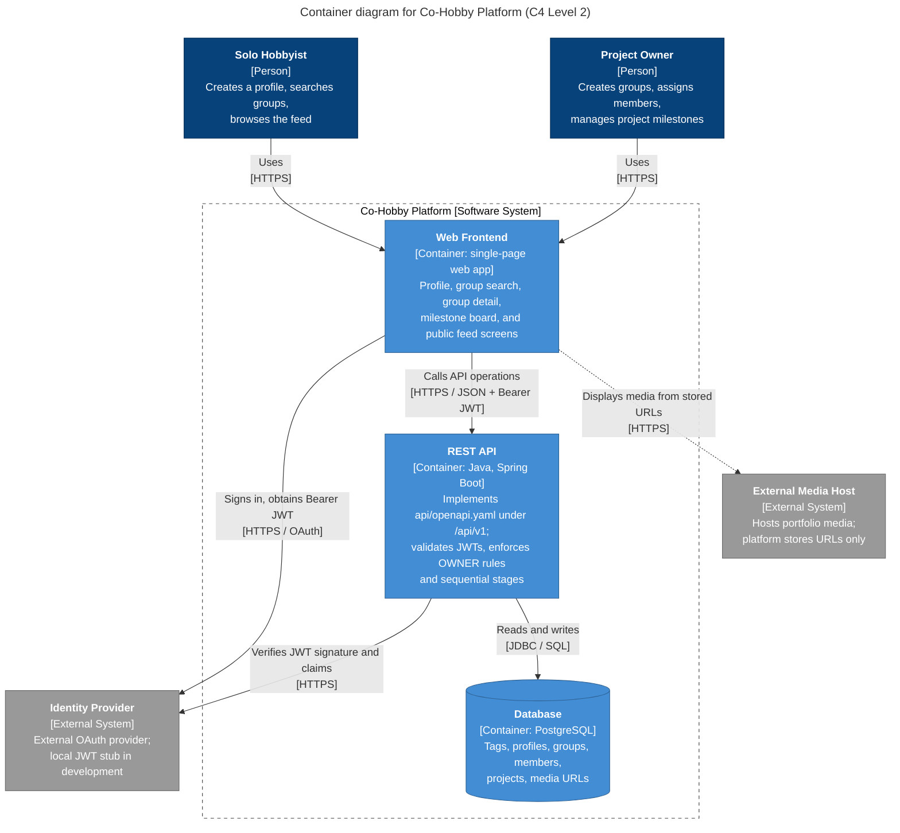

# Software Architecture Documentation

**Course:** SENG 321 Software Engineering
**Team:** 19
**Project:** Co-Hobby
**Sprint:** 2
**Status:** Ready for review — authored by @Bruhun (Issue #32); UML class and sequence diagrams by @bakicanerdogan (Issue #34)

> Document the architecture using C4 models and UML diagrams.
> Diagram sources live in this file and in `docs/diagrams/`; commit PNG exports alongside them
> so diagrams survive independently of any external tool or link.
> C4 Level 1 below is already drawn and must stay consistent with `docs/02-vision-and-boundary.md`.

## 1. Purpose and Scope

This document records the first-release architecture of Co-Hobby: the system context (C4 Level 1), the deployable containers (C4 Level 2), the UML models, and the design decisions that shape them. It sits between the requirements and the implementation:

- **What the system must do** comes from the SRS (`docs/06-srs.md`) and the API contract (`api/openapi.yaml`).
- **How well it must do it** comes from the NFR catalogue (`docs/07-nfr-quality-measures.md`). Every design decision in §4 names the NFRs that drove it.
- **How it is built** is described here, and Sprint 3 implementation follows it.

The scope is the first release only (US-01 through US-07). Deferred features (chat, payments, notifications, swipe matching, raw media hosting, administration) do not appear in any diagram.

## 2. Architecture Overview

Co-Hobby is a **layered monolith**: one Spring Boot REST API that holds all domain logic, a browser-based web frontend that calls it over HTTPS/JSON, and a single relational database. The API implements exactly the operations in `api/openapi.yaml`. It validates Bearer JWTs issued by an **external identity provider**; during development, a documented local JWT stub keeps the same boundary. Portfolio media stays on **external media hosts**: the platform stores and returns URLs only, never the files. There is no chat, payment, notification, or administration component in the first release.

## 3. C4 Model

### 3.1 Level 1 — System Context (Issue #32) ✅

> The Co-Hobby Platform as a single system, its users, and its external systems.
> Person/System/External-System mapping follows the C4 model.
> Consistent with `docs/02-vision-and-boundary.md`: no new actors or systems were added.

**Relationship notes (read with the diagram):**

- The media host has **no runtime integration** with Co-Hobby: the platform only stores user-provided URLs in profiles; nothing flows from the host into the system. The arrow direction here deliberately corrects the Sprint 1 sketch, which drew this relationship as `Media → System`.
- **Platform Administrators are omitted on purpose** — the first release has no moderation or administration features (deferred in `docs/01-project-proposal.md`).
- Local development uses HTTP; deployed environments require HTTPS (`docs/02-vision-and-boundary.md`).

**Notation:** the diagrams use C4 colour conventions drawn as Mermaid flowcharts, which render more legibly on GitHub than Mermaid's experimental `C4Context` syntax. Dark blue = people (actors), blue = Co-Hobby itself (Level 1) or its containers (Level 2), grey = external systems. Solid arrows show the direction a request flows; the dotted arrow is a stored URL reference with no runtime call.

> If the Mermaid block does not render in your viewer, use the standalone Mermaid source in
> [`docs/diagrams/c4-context.md`](diagrams/c4-context.md) or the PNG export
> [`docs/diagrams/c4-context.png`](diagrams/c4-context.png).

### 3.2 Level 2 — Containers (Issue #32)

> Zooms into the Co-Hobby Platform box from Level 1. People and external systems are the same
> as Level 1; nothing new was added. Source: [`docs/diagrams/c4-containers.md`](diagrams/c4-containers.md);
> PNG export: [`docs/diagrams/c4-containers.png`](diagrams/c4-containers.png).

**Container responsibilities:**

| Container | Technology | Responsibilities | Contract / Interface |
|---|---|---|---|
| Web Frontend | Single-page web app (framework chosen in Sprint 3) | Renders the first-release screens from `docs/09-ui-ux.md`; attaches the Bearer JWT to write requests; shows `application/problem+json` errors to the user | Consumes `api/openapi.yaml` |
| REST API | Java, Spring Boot | All domain rules: profile validation, OWNER-only mutations (403), vacancy and duplicate checks (409), sequential stages and share-only-when-`COMPLETED` (409) | Implements `api/openapi.yaml` (`/api/v1`) |
| Database | Relational (PostgreSQL) | Persists tags, profiles, groups, members, projects, and media URLs; enforces uniqueness and foreign keys | JDBC, accessed only by the REST API |

**Relationship notes:**

- Only the REST API touches the database; the frontend never accesses data directly.
- Public operations (`getTags`, `listAvailableGroups`, `getSharedProjectsFeed`) are called without a token; all write operations carry the Bearer JWT (`docs/02-vision-and-boundary.md`).
- The media host is still **not called by the API**. Media URLs pass through the API as plain data, and the browser loads them directly. This matches the Level 1 note.
- Local development uses HTTP; deployed environments use HTTPS on every link.

### 3.3 Level 3 — Components

Intentionally omitted. Issue #32 asks for Level 3 only if the assessment rubric requires it, and the Sprint 2 assignment text lists "C4 models" without naming Level 3. The internal layering of the REST API is described in DD-01 and in the UML class diagram (`docs/diagrams/uml-class.md`).

## 4. Design Decisions

> Each decision lists its context, the decision, the rationale, the consequences, and the NFRs
> (from `docs/07-nfr-quality-measures.md`) that drove it.

### DD-01 Layered Monolith

- **Context:** A six-person student team, a small domain (tags, profiles, groups, members, projects), and a class-scale user base.
- **Decision:** Build one deployable Spring Boot service with three layers: controllers (HTTP and validation), services (domain rules), and repositories (persistence). Layers call only the layer directly below them.
- **Rationale:** The layered architecture pattern from the course architecture slides gives a clean separation of concerns and lets each layer be tested on its own. A single deployable avoids the network, deployment, and consistency cost of microservices that the scope does not need.
- **Consequences:** Simple build, deploy, and debugging for the first release. Horizontal scaling is limited to running more copies of the same service, which is enough for class-scale load. Domain rules live only in the service layer, so a rule change touches one place.
- **NFRs:** NFR-M-02 (testable, reviewable codebase), NFR-P-01 (latency is verified against one service, not a chain of services).

### DD-02 OpenAPI-First Contract

- **Context:** Frontend and backend will be built in parallel by different team members in Sprint 3.
- **Decision:** `api/openapi.yaml` is the single source of truth for every endpoint, schema, and status code. Code follows the contract; a contract change goes through a reviewed PR before the code that depends on it.
- **Rationale:** Both containers can be built and tested against the same contract at the same time. The existing Redocly lint workflow already checks the contract on every PR that changes it.
- **Consequences:** Schema changes need a PR review, which slows ad-hoc changes but keeps the frontend, backend, SRS, and tests in sync. Integration tests can assert the documented status codes (400, 401, 403, 404, 409) directly.
- **NFRs:** NFR-M-01 (contract lint passes on every PR), NFR-S-03 (media URI validation defined in the schema).

### DD-03 Authentication Boundary (External IdP with Local Stub)

- **Context:** Identity-token issuance is outside the system boundary (`docs/02-vision-and-boundary.md`), and Sprint 1 recorded the risk that the external provider may be unavailable during development.
- **Decision:** The team does not build an identity provider. The REST API only validates Bearer JWTs at its boundary and reads the user ID from the token. Authorization (OWNER vs MEMBER) is checked in the service layer against the group's member list. A documented local JWT stub issues test tokens during development.
- **Rationale:** Keeps identity logic out of the first-release scope while still enforcing the security rules in the contract. The stub exposes the same interface as the real provider, so switching providers does not change the API.
- **Consequences:** The same API behaviour in tests and production. The stub must never ship to a deployed environment, and no identity logic may leak from the stub into domain code.
- **NFRs:** NFR-S-01 (all writes require a valid JWT, 401), NFR-S-02 (OWNER-restricted mutations return 403).

### DD-04 Relational Data Storage

- **Context:** The domain is structured and strongly related: members belong to groups, projects belong to groups, and stages follow a fixed order.
- **Decision:** Use a relational database (PostgreSQL) accessed only by the REST API, with uniqueness and foreign-key constraints matching the domain rules.
- **Rationale:** Constraints such as one member per role slot and one membership per user per group can be enforced by the database as well as by the service layer. ACID transactions stop two concurrent requests from filling the same vacancy or advancing the same project twice.
- **Consequences:** The schema needs versioned migrations from Sprint 3 onward. Concurrency conflicts surface as `409 Conflict` responses rather than inconsistent data.
- **NFRs:** NFR-R-01 (domain rules never allow invalid state; all 409 paths hold).

## 5. UML Diagrams

- Use-case diagram and milestone state diagram: `docs/diagrams/` (Issue #33, @Bruhun)
- Domain class diagram (Issue #34, @bakicanerdogan): [`uml-class.md`](diagrams/uml-class.md) / [`uml-class.png`](diagrams/uml-class.png)
- Sequence diagram, `addGroupMember` (Issue #34, @bakicanerdogan): [`uml-seq-add-member.md`](diagrams/uml-seq-add-member.md) / [`uml-seq-add-member.png`](diagrams/uml-seq-add-member.png)
- Sequence diagram, `updateProjectProgress` (Issue #34, @bakicanerdogan): [`uml-seq-progress.md`](diagrams/uml-seq-progress.md) / [`uml-seq-progress.png`](diagrams/uml-seq-progress.png)

> Diagrams are committed as Mermaid sources and PNG exports and are cross-referenced from
> `docs/06-srs.md` use cases.

## 6. Consistency with Sprint 1 Boundary

- C4 Level 1 must not add actors, external systems, or responsibilities missing from `docs/02-vision-and-boundary.md`.
- The API still follows `api/openapi.yaml`; if a requirement forces a contract change, update
  the contract in the same PR.
- Deferred items stay out: chat, payments, notifications, swipe matching, raw media hosting,
  administration panels, identity-provider implementation.
