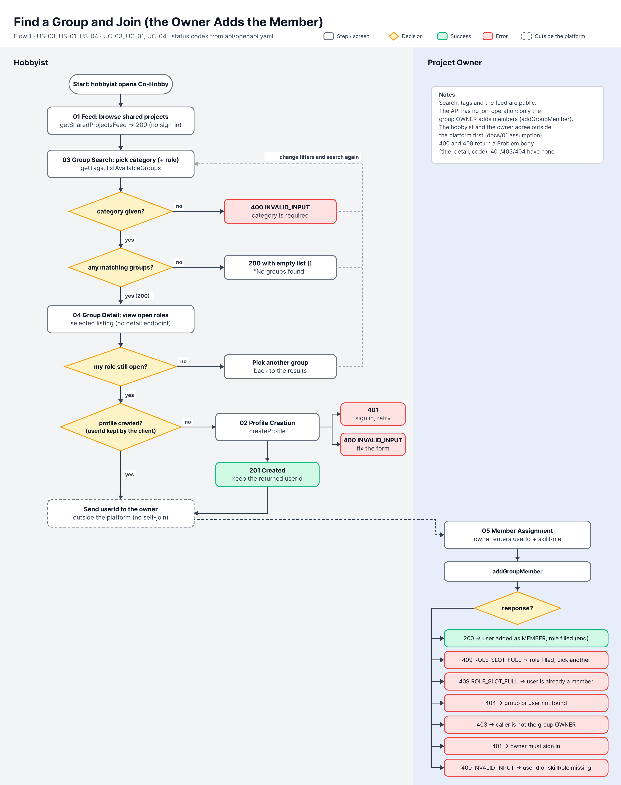
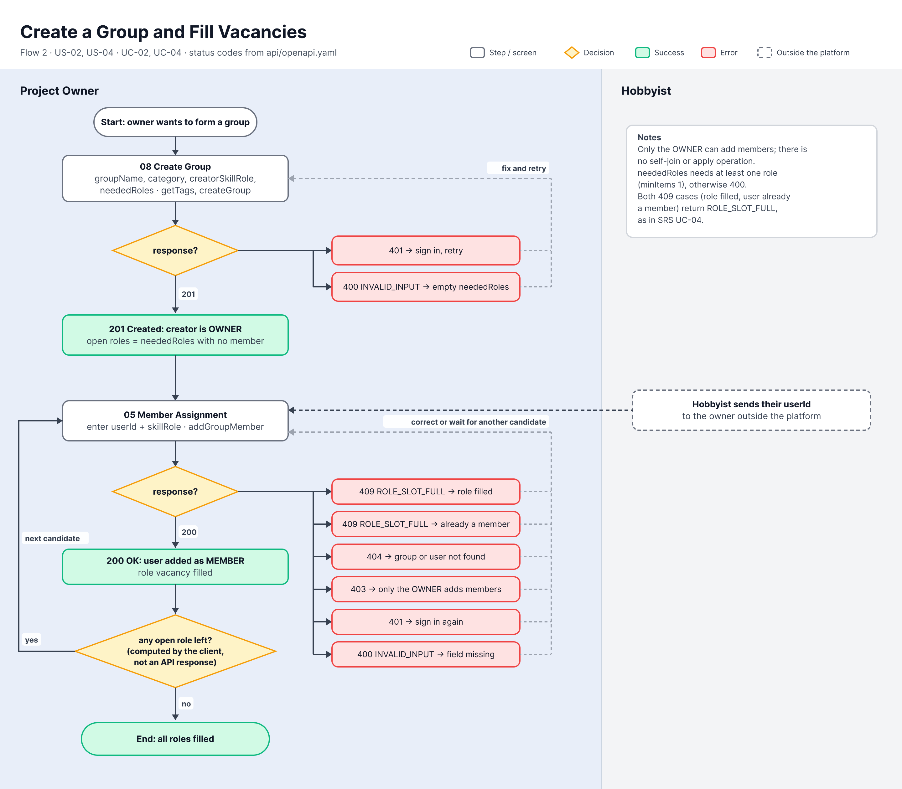
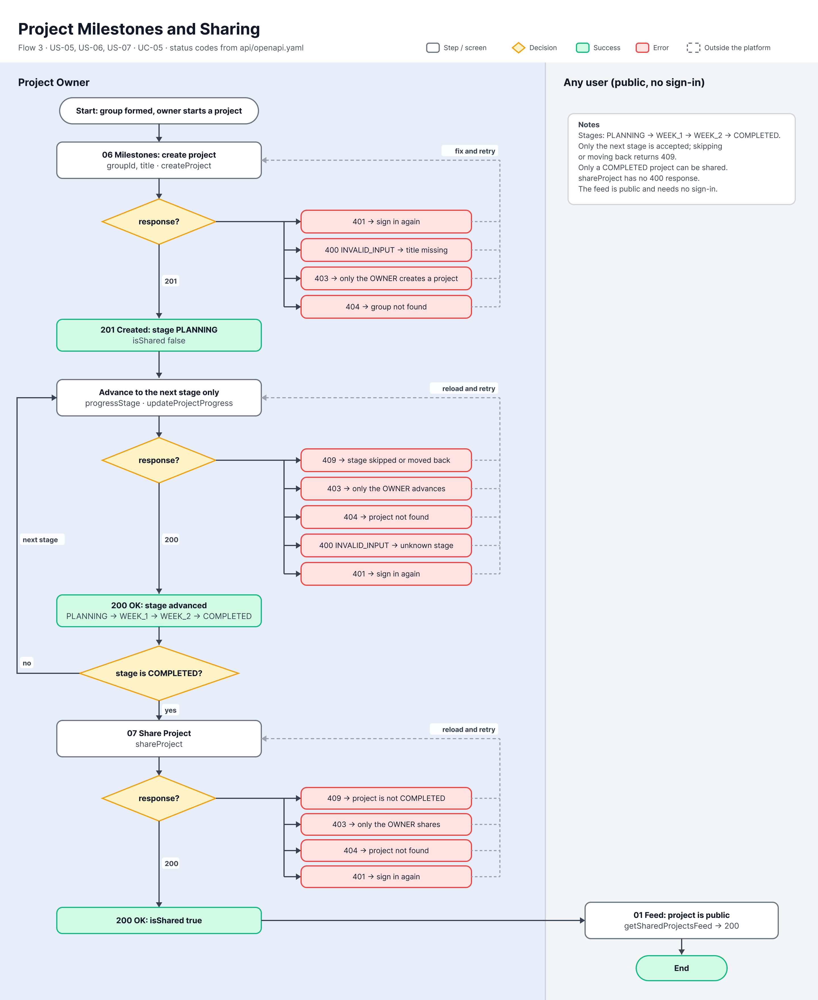

# UI/UX Prototypes and User Flows

**Course:** SENG 321 Software Engineering
**Team:** 19
**Project:** Co-Hobby
**Sprint:** 2
**Status:** Final (released in `sprint-2`) — skeleton prepared by @Bruhun, authored by @bakicanerdogan (Issues #30, #31), product input @beyazitKRGL

> The UI/UX deliverable is the Figma project **including user-flow diagrams**.
> This document links the Figma file and commits exported PNGs so the artifacts survive
> independently of the Figma link. The Figma link must be **public view-only**.

## 1. Figma Project

- **Figma link (public view-only):** https://www.figma.com/design/SqIaYZLZ0fSslWjnXHuRf8/Co-Hobby-Sprint-2-UI-UX
- **Figma file:** "Co-Hobby Sprint 2 UI/UX", page **Screens** (one 1440 px frame per screen, named as in §2) and page **User Flows** (one 1440 px frame per flow, named as in §3).
- **Figma workspace owner:** @bakicanerdogan
- **Product owner consulted:** @beyazitKRGL
- If the link is set to private/restricted, this deliverable cannot be graded.

**Sources:** each screen is designed as a self-contained HTML mockup in [`docs/figma/src/`](figma/src/) (shared stylesheet `styles.css`, no external dependencies) and rendered to the PNGs listed below. The PNGs are placed in the Figma file as one frame per screen with prototype links between them. The HTML sources and PNGs stay in the repository, so the screens remain reviewable even without the Figma link.

## 2. Prototype Screens (Issue #30)

> Each screen maps to a use case in `docs/06-srs.md` and uses only fields defined in
> `api/openapi.yaml` (for example `displayName`, `bio`, `primaryCategory`, `skillRole`,
> `mediaUrls`, `userId`, `groupName`, `description`, `category`, `creatorSkillRole`,
> `neededRoles`, `members`, `memberRole`, `title`, `progressStage`, `isShared`). Names, places
> and group or project titles are sample data for the prototype (some, such as "Ankara Indie
> Collective" and "First EP Recording", come from the contract examples). The scenario is
> consistent across screens: Deniz Yılmaz creates a Drummer profile (Screen 2) and views Ankara
> Indie Collective (Screen 4); the group's owner, Ahmet Demir, then adds Deniz as the Drummer
> using the user ID from Screen 2 (Screen 5 shows both the success and the `ROLE_SLOT_FULL`
> outcome).

| # | Screen | Covers Story / Use Case | SRS Requirement | API Operations | Figma Frame | Exported PNG |
|---|---|---|---|---|---|---|
| 1 | Landing / Public Project Feed | US-07 / UC-05 | FR-3.3 | `getSharedProjectsFeed` | `01 Feed` | [`01-feed.png`](figma/01-feed.png) |
| 2 | Profile Creation | US-01 / UC-01 | FR-1.1, FR-1.2 | `getTags`, `createProfile` | `02 Profile Creation` | [`02-profile-creation.png`](figma/02-profile-creation.png) |
| 3 | Group Search Results (category + role filters) | US-03 / UC-03 | FR-2.2 (filter options: FR-1.1) | `getTags`, `listAvailableGroups` | `03 Group Search` | [`03-group-search.png`](figma/03-group-search.png) |
| 4 | Group Detail with Open Roles / Vacancies | US-03 / UC-03 | FR-2.2 | `listAvailableGroups` (selected item) | `04 Group Detail` | [`04-group-detail.png`](figma/04-group-detail.png) |
| 5 | Owner Member-Assignment View | US-04 / UC-04 | FR-2.3 | `addGroupMember` | `05 Member Assignment` | [`05-member-assignment.png`](figma/05-member-assignment.png) |
| 6 | Project Milestone Board (PLANNING → WEEK_1 → WEEK_2 → COMPLETED) | US-05, US-06 / UC-05 | FR-3.1, FR-3.2 | `createProject`, `updateProjectProgress` | `06 Milestones` | [`06-milestones.png`](figma/06-milestones.png) |
| 7 | Share Completed Project Dialog | US-07 / UC-05 | FR-3.3 | `shareProject` | `07 Share Project` | [`07-share-project.png`](figma/07-share-project.png) |
| 8 | Group Creation Form | US-02 / UC-02 | FR-2.1 (role options: FR-1.1) | `getTags`, `createGroup` | `08 Create Group` | [`08-create-group.png`](figma/08-create-group.png) |

Use case and requirement numbers follow `docs/06-srs.md` (UC-01 to UC-05, FR-1.1 to FR-3.3) and its traceability matrix (section 8). Screen 8 was added because US-02 had no screen in the original list. Screen 4 maps to UC-03 (step 4: the user views a group listing and its open roles) rather than UC-02, which covers group creation.

### 2.1 States Shown per Screen

Each screen shows its success state and its main error or empty states. Status codes that are not drawn are listed in the screen's notes band (marked "notes" below). `400` and `409` errors are rendered from the `Problem` body (`title`, `detail`, `code`); `401`, `403` and `404` have no body in the contract, so their messages are fixed UI text.

| # | Success | Error / Empty States |
|---|---|---|
| 1 | Shared project list | Empty feed; `400` (notes) |
| 2 | `201` + the returned `userId` | `400` (invalid media URL), `401` |
| 3 | Matching groups with open roles | `200` empty list, `400` (missing `category`) |
| 4 | Hobbyist view and owner view of the same group | Owner-only actions hidden for non-owners (API still returns `403`) |
| 5 | `200`, role filled, new `MEMBER` | `409 ROLE_SLOT_FULL`, `409` duplicate member, `404`, `403`, `400` |
| 6 | Board in `WEEK_1` with only the next stage offered | Empty state with the create form (`PLANNING`), `409` stage skipped/backward, `403`, `404`; `400` (notes) |
| 7 | `200`, `isShared: true` | `409` project not `COMPLETED`, `403`, `404` |
| 8 | `201`, creator is `OWNER` | `400` (empty `neededRoles`), `401` |

`401` is shown as a shared "Sign in required" banner. Sign-in happens at the external identity provider (`docs/02-vision-and-boundary.md`), so there is no in-app login form.

### 2.2 Design Decisions Forced by the API Contract

- **No self-join.** The first release has no join or apply operation; only the OWNER adds members (`addGroupMember`). The group detail screen therefore has no "Join" button. It tells the hobbyist to send the owner their user ID, which `createProfile` returns (Screen 2) and the owner enters on Screen 5. This follows the assumption in `docs/01-project-proposal.md` that owners and hobbyists agree on joining outside the platform before the owner adds a member.
- **No group-detail endpoint.** Screen 4 reuses the `GroupListingResponse` item selected on Screen 3.
- **Open roles are derived.** A role is open when it is listed in `neededRoles` and no member's `skillRole` matches it; the creator's role is `creatorSkillRole`.
- **No member names.** `GroupMember` carries only `userId`, `memberRole` and `skillRole`, so members are shown by role and a shortened ID.
- **No project media.** `ProjectResponse` has no media field, so feed entries are text-only; portfolio media stays on profiles as external URLs.
- **Next stage only.** The milestone board offers only the next stage; `409` is still handled for stale views.
- **User ID is shown once.** The API has no operation to read a profile back, so the `userId` returned by `createProfile` (Screen 2) must be kept by the client; Screens 4 and 5 assume it is available.
- **Only open groups are searchable.** `listAvailableGroups` returns open groups, and there is no operation to read a project or group by ID; the milestone board therefore relies on the project response kept from `createProject`.

## 3. User-Flow Diagrams (Issue #31)

The three core journeys are drawn in the same Figma file on the page **User Flows**, one 1440 px frame per flow, and exported at 2x into [`docs/diagrams/`](diagrams/). All three use the same notation:

- **White box:** a step or a neutral result, such as an empty search result. Screen numbers refer to §2, and operation names to `api/openapi.yaml`.
- **Yellow diamond:** a decision.
- **Green box:** a success response, or the end of a flow.
- **Red box:** an error response.
- **Dashed box and dashed dark arrow:** a step that happens outside the platform, such as sending the user ID to the owner.
- **Dashed grey arrow:** the way back to an earlier step to try again, after an error, an empty search result or a role that is no longer open.

Status codes come from `api/openapi.yaml`. Every error response that an operation in the flow defines is drawn. The only exceptions are the `400` responses of `getTags` and `getSharedProjectsFeed`: neither operation takes input, so they do not create a decision in any flow.

### Flow 1 — Find a Group and Join (the Owner Adds the Member)

- **Figma frame:** page `User Flows`, frame `Flow 1 Find Group`
- **Covers:** US-03, US-01, US-04 / UC-03, UC-01, UC-04

The hobbyist starts on the public feed (Screen 1) and opens the group search (Screen 3). There they pick a category and, optionally, the role they play; searching needs no sign-in. From the results they open a group (Screen 4) and check whether their role is still open. If it is not, they go back to the results.

The API has no join operation, so the hobbyist cannot join by themselves (see §2.2). If they have no profile yet, they create one (Screen 2) and keep the `userId` that `createProfile` returns. They send this ID to the group's owner outside the platform. The owner then adds them on Screen 5 with `addGroupMember`. When it returns `200`, the hobbyist is a `MEMBER` in that role.

| Step | Operation | Response | Branch |
|---|---|---|---|
| Search | `listAvailableGroups` | `400` (`INVALID_INPUT`) | `category` is missing or invalid; the hobbyist picks a category. |
| Search | `listAvailableGroups` | `200` with `[]` | No group matches; the hobbyist changes the filters. |
| Create profile | `createProfile` | `401` | Not signed in; the hobbyist signs in and retries. |
| Create profile | `createProfile` | `400` (`INVALID_INPUT`) | A required field is missing or a media URL is invalid. |
| Owner adds member | `addGroupMember` | `409` (`ROLE_SLOT_FULL`) | The role was filled in the meantime; the hobbyist picks another group. |
| Owner adds member | `addGroupMember` | `409` (`ROLE_SLOT_FULL`) | The user is already a member of the group. |
| Owner adds member | `addGroupMember` | `404` | The group or the user ID is unknown, for example a mistyped ID. |
| Owner adds member | `addGroupMember` | `403` | The caller is not the group's `OWNER`. |
| Owner adds member | `addGroupMember` | `401` | The owner is not signed in. |
| Owner adds member | `addGroupMember` | `400` (`INVALID_INPUT`) | `userId` or `skillRole` is missing or invalid. |

### Flow 2 — Create a Group and Fill Vacancies (Project Owner Journey)

- **Figma frame:** page `User Flows`, frame `Flow 2 Create Group`
- **Covers:** US-02, US-04 / UC-02, UC-04

The owner fills in the group creation form (Screen 8) with `groupName`, `category`, `creatorSkillRole` and at least one entry in `neededRoles`, and submits it with `createGroup`. When it returns `201`, the group exists and the creator is its `OWNER`. The open roles are the entries in `neededRoles` that no member's `skillRole` matches yet.

A hobbyist who wants a role sends their user ID to the owner outside the platform. The owner enters this ID and the role on Screen 5 and calls `addGroupMember`. After each `200`, the owner checks whether any role is still open. This check is done by the client from `neededRoles` and `members`; the API does not return it. If a role is still open, the owner waits for the next candidate. When all roles are filled, the flow ends.

| Step | Operation | Response | Branch |
|---|---|---|---|
| Create group | `createGroup` | `401` | Not signed in; the owner signs in and retries. |
| Create group | `createGroup` | `400` (`INVALID_INPUT`) | `neededRoles` is empty or a required field is missing. |
| Add member | `addGroupMember` | `409` (`ROLE_SLOT_FULL`) | The role is already filled. |
| Add member | `addGroupMember` | `409` (`ROLE_SLOT_FULL`) | The user is already a member. As in SRS UC-04, both conflicts use the same code. |
| Add member | `addGroupMember` | `404` | The group or the user is unknown. |
| Add member | `addGroupMember` | `403` | Only the `OWNER` can add members. |
| Add member | `addGroupMember` | `401` | Not signed in. |
| Add member | `addGroupMember` | `400` (`INVALID_INPUT`) | `userId` or `skillRole` is missing or invalid. |

### Flow 3 — Project Milestones and Sharing (Project Owner Journey)

- **Figma frame:** page `User Flows`, frame `Flow 3 Project Share`
- **Covers:** US-05, US-06, US-07 / UC-05

Once the group is formed, the owner creates a project on the milestone board (Screen 6) with the group's ID and a title. `createProject` returns `201` with the project in stage `PLANNING` and `isShared` set to `false`. The owner then moves the project forward one stage at a time with `updateProjectProgress`: `PLANNING` → `WEEK_1` → `WEEK_2` → `COMPLETED`. The flow loops on this step until the stage is `COMPLETED`.

The owner then shares the project from the share dialog (Screen 7) with `shareProject`. When it returns `200`, `isShared` is `true` and the project appears in the public feed (Screen 1, `getSharedProjectsFeed`), which anyone can read without signing in.

| Step | Operation | Response | Branch |
|---|---|---|---|
| Create project | `createProject` | `401` | Not signed in. |
| Create project | `createProject` | `400` (`INVALID_INPUT`) | `title` or `groupId` is missing or invalid. |
| Create project | `createProject` | `403` | Only the group's `OWNER` can create a project. |
| Create project | `createProject` | `404` | The group is unknown. |
| Advance stage | `updateProjectProgress` | `409` | A stage was skipped or the project was moved backward. The board offers only the next stage, so this mainly covers stale views. |
| Advance stage | `updateProjectProgress` | `403` | Only the `OWNER` can advance the stage. |
| Advance stage | `updateProjectProgress` | `404` | The project is unknown. |
| Advance stage | `updateProjectProgress` | `400` (`INVALID_INPUT`) | `progressStage` is missing or not a known stage. |
| Advance stage | `updateProjectProgress` | `401` | Not signed in. |
| Share | `shareProject` | `409` | The project is not `COMPLETED` yet. |
| Share | `shareProject` | `403` | Only the `OWNER` can share the project. |
| Share | `shareProject` | `404` | The project is unknown. |
| Share | `shareProject` | `401` | Not signed in. |

`shareProject` defines no `400` response, so none is drawn.

## 4. Traceability and Review

> A quick table for QA and the final submission report.

| Artifact | Linked Story / Use Case | Figma Page/Frame | Export Path | Reviewer |
|---|---|---|---|---|
| Prototype (all screens) | US-01 … US-07 / UC-01 … UC-05 | Page `Screens`, frames `01`–`08` | `docs/figma/` (sources in `docs/figma/src/`) | @beyazitKRGL |
| Find-group flow | US-03 (with US-01, US-04) / UC-03, UC-01, UC-04 | Page `User Flows`, frame `Flow 1 Find Group` | `docs/diagrams/user-flow-find-group.png` | @yigitozkaya07 |
| Create-group flow | US-02, US-04 / UC-02, UC-04 | Page `User Flows`, frame `Flow 2 Create Group` | `docs/diagrams/user-flow-create-group.png` | @yigitozkaya07 |
| Project-share flow | US-05, US-06, US-07 / UC-05 | Page `User Flows`, frame `Flow 3 Project Share` | `docs/diagrams/user-flow-project-share.png` | @yigitozkaya07 |
