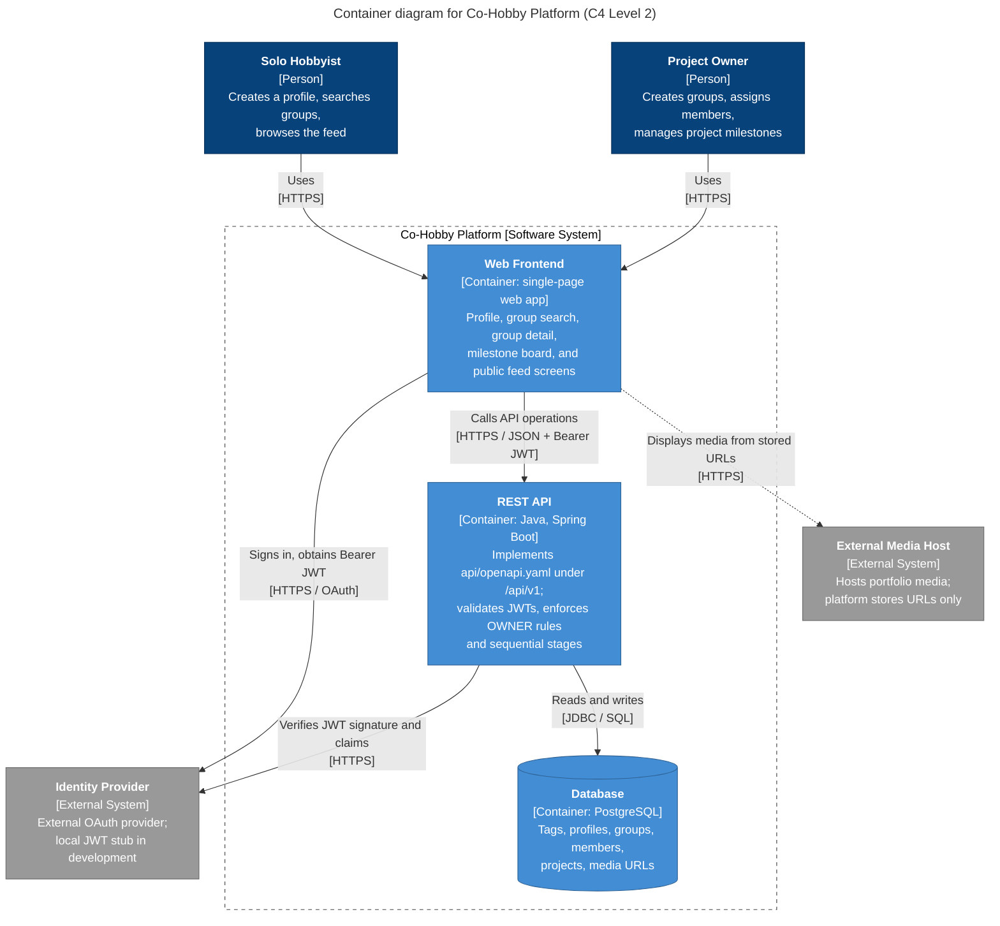

# C4 Level 2 — Container Diagram (standalone source)

Canonical copy lives in `docs/08-architecture.md` §3.2. Keep this file in sync when the diagram changes.

PNG export: `c4-containers.png`, rendered from the block above with Mermaid (mermaid.live or mermaid-cli).
