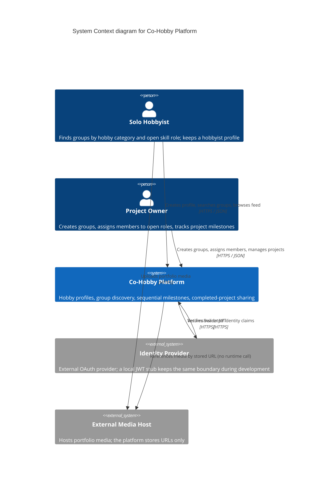

# C4 Level 1 — System Context Diagram (standalone source)

Canonical copy lives in `docs/08-architecture.md` §3.1. Keep this file in sync when the diagram changes.

PNG export: `c4-context.png` — generate via <https://mermaid.live> (paste the block above, download PNG).
