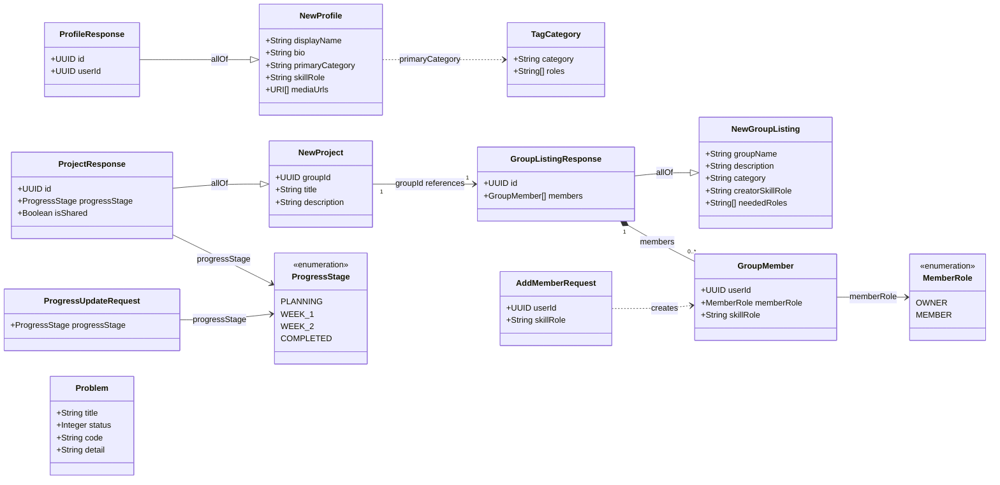

# UML Domain Class Diagram

Source of truth: `api/openapi.yaml` component schemas. Every attribute below maps to an
OpenAPI property. PNG export: `uml-class.png`.

## Attribute cross-check

| Class | Attributes | OpenAPI schema |
|---|---|---|
| NewProfile | displayName, bio, primaryCategory, skillRole, mediaUrls | `NewProfile` |
| ProfileResponse | id, userId (+ NewProfile) | `ProfileResponse` |
| NewGroupListing | groupName, description, category, creatorSkillRole, neededRoles | `NewGroupListing` |
| GroupListingResponse | id, members (+ NewGroupListing) | `GroupListingResponse` |
| GroupMember | userId, memberRole, skillRole | `GroupMember` |
| AddMemberRequest | userId, skillRole | `AddMemberRequest` |
| NewProject | groupId, title, description | `NewProject` |
| ProjectResponse | id, progressStage, isShared (+ NewProject) | `ProjectResponse` |
| ProgressUpdateRequest | progressStage | `ProgressUpdateRequest` |
| Problem | title, status, code, detail | `Problem` |
| TagCategory | category, roles | `TagCategory` |

Note: `ProfileResponse`, `GroupListingResponse`, and `ProjectResponse` inherit their base
attributes through `allOf`; the diagram shows this as generalization instead of repeating them.
