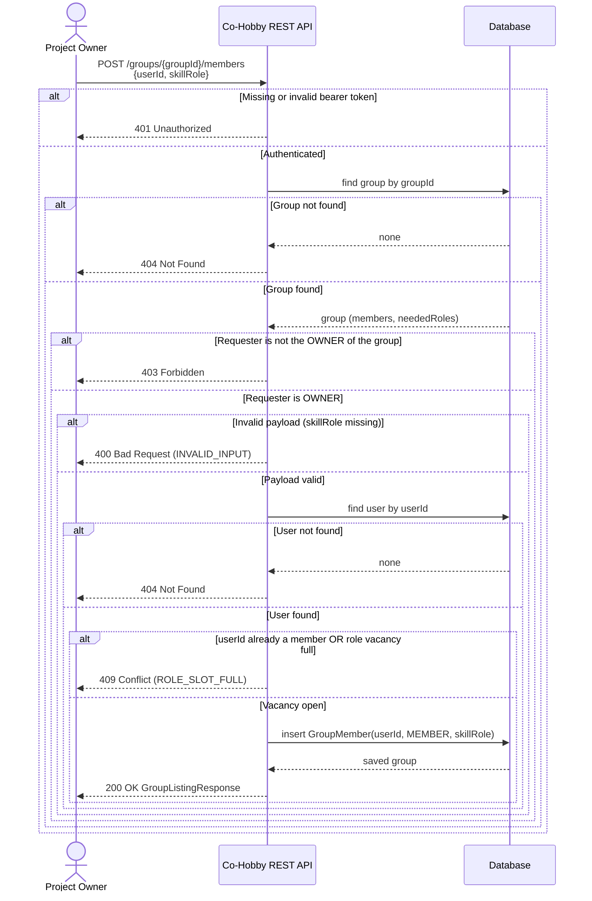

# UML Sequence — POST /groups/{groupId}/members (addGroupMember)

Owner assigns a member to an open skill role. Covers 400, 401, 403, 404, and 409 from
`api/openapi.yaml`.
PNG export: `uml-seq-add-member.png`.

## Response mapping

| Status | Condition | OpenAPI |
|---|---|---|
| 200 | Member assigned, returns `GroupListingResponse` | `addGroupMember` `'200'` |
| 400 | Invalid payload | `BadRequest` |
| 401 | Missing/invalid auth | `'401'` |
| 403 | Caller is not the Project Owner | `'403'` |
| 404 | Group or user not found | `'404'` |
| 409 | Duplicate member or filled vacancy (`ROLE_SLOT_FULL`) | `'409'` |
