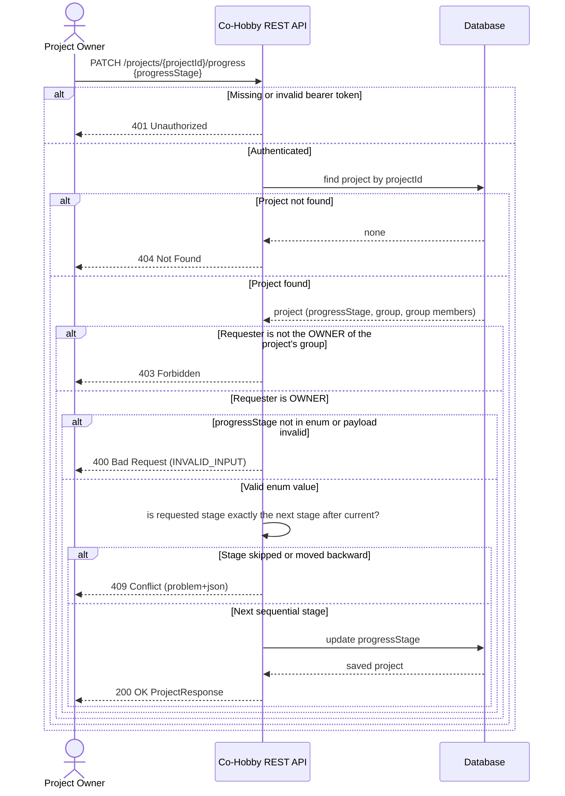

# UML Sequence — PATCH /projects/{projectId}/progress (updateProjectProgress)

Advances a project milestone strictly sequentially: PLANNING → WEEK_1 → WEEK_2 → COMPLETED.
Skipped or backward stages return 409. Covers 400, 401, 403, 404, and 409 from `api/openapi.yaml`.
PNG export: `uml-seq-progress.png`.

## Stage guard

| Current stage | Allowed next | Anything else |
|---|---|---|
| PLANNING | WEEK_1 | 409 |
| WEEK_1 | WEEK_2 | 409 |
| WEEK_2 | COMPLETED | 409 |
| COMPLETED | — (terminal) | 409 |

## Response mapping

| Status | Condition | OpenAPI |
|---|---|---|
| 200 | Stage advanced, returns `ProjectResponse` | `updateProjectProgress` `'200'` |
| 400 | Invalid payload | `BadRequest` |
| 401 | Missing/invalid auth | `'401'` |
| 403 | Caller is not the Project Owner | `'403'` |
| 404 | Project not found | `'404'` |
| 409 | Stage skipped or moved backward | `'409'` |

Note: the 403 follows the owner-only rule in `api/openapi.yaml` ("Only the Project Owner can advance
the project progress stage"), the same rule as US-06 and the other owner-only endpoints
(`addGroupMember`, `createProject`, `shareProject`).
