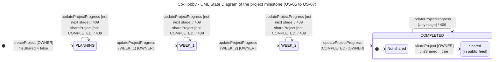

# UML State Diagram — Project Milestone Lifecycle

Lifecycle of a project (`ProjectResponse.progressStage` and `isShared` in `api/openapi.yaml`),
covering US-05, US-06 and US-07 (SRS UC-05). PNG export: `uml-state.png`.

## Transitions

| From | Event [guard] | To | Response |
|---|---|---|---|
| (initial) | `createProject` [requester is OWNER] / `isShared = false` | PLANNING | 201 |
| PLANNING | `updateProjectProgress(WEEK_1)` [OWNER] | WEEK_1 | 200 |
| WEEK_1 | `updateProjectProgress(WEEK_2)` [OWNER] | WEEK_2 | 200 |
| WEEK_2 | `updateProjectProgress(COMPLETED)` [OWNER] | COMPLETED (Not shared) | 200 |
| COMPLETED: Not shared | `shareProject` [OWNER] / `isShared = true` | COMPLETED: Shared | 200 |
| PLANNING, WEEK_1, WEEK_2 | `updateProjectProgress` [not the next stage: skipped or backward] | same state | 409 |
| PLANNING, WEEK_1, WEEK_2 | `shareProject` [not COMPLETED] | same state | 409 |
| COMPLETED | `updateProjectProgress` [any stage] | same state | 409 |

## Notes

- **Sequential guard:** the only allowed progress transition is to the next stage
  (PLANNING → WEEK_1 → WEEK_2 → COMPLETED), matching `updateProjectProgress` in
  `api/openapi.yaml` and the stage guard table in `uml-seq-progress.md`.
- **Sharing guard:** `isShared` is a separate boolean, not a fifth stage, so sharing is drawn as
  two substates inside the composite state COMPLETED. Only a COMPLETED project can be shared;
  shared projects are returned by `getSharedProjectsFeed`.
- **No final state:** the API has no delete or archive operation, and a shared project stays in
  the public feed.
- **Not drawn:** 400, 401, 403 and 404 responses never change the state of a project, so they are
  left out of the diagram; they are covered in `docs/06-srs.md` UC-05 and the sequence diagrams.
- The diagram uses Mermaid's ELK layout so the self-transitions do not overlap. Where ELK is not
  available the default layout is used; the PNG export is the reference rendering.
