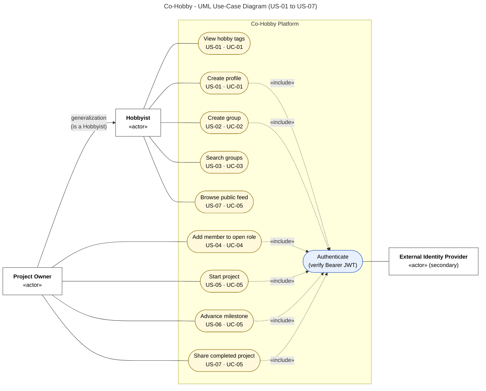

# UML Use-Case Diagram

Covers the seven first-release user stories (US-01 to US-07) and no other scope. Each use case is
tagged with its user story and the SRS use case that describes its flows (`docs/06-srs.md` §4).
PNG export: `uml-use-case.png`.

## Actors

| Actor | Kind | Notes |
|---|---|---|
| Hobbyist | Primary | Registered user. Viewing tags, searching groups and browsing the feed also work without login. |
| Project Owner | Primary | A Hobbyist who created a group (OWNER member role). Inherits every Hobbyist use case through the generalization. |
| External Identity Provider | Secondary | Issues the identity tokens the system verifies; a local JWT stub keeps the same boundary in development. |

## Use cases

| Use case | Actor | User story | SRS use case | API operation |
|---|---|---|---|---|
| View hobby tags | Hobbyist | US-01 | UC-01 | `getTags` |
| Create profile | Hobbyist | US-01 | UC-01 | `createProfile` |
| Create group | Hobbyist (becomes Project Owner) | US-02 | UC-02 | `createGroup` |
| Search groups | Hobbyist | US-03 | UC-03 | `listAvailableGroups` |
| Browse public feed | Hobbyist | US-07 | UC-05 | `getSharedProjectsFeed` |
| Add member to open role | Project Owner | US-04 | UC-04 | `addGroupMember` |
| Start project | Project Owner | US-05 | UC-05 | `createProject` |
| Advance milestone | Project Owner | US-06 | UC-05 | `updateProjectProgress` |
| Share completed project | Project Owner | US-07 | UC-05 | `shareProject` |
| Authenticate («include») | External Identity Provider | Shared by US-01, US-02, US-04 to US-07 | "System authenticates the token" step of UC-01, UC-02, UC-04, UC-05 | Bearer JWT check on every non-public operation |

## Notation notes

- **Generalization:** Project Owner is a Hobbyist. Mermaid flowcharts cannot draw the UML hollow
  triangle arrowhead, so the generalization is drawn as a labelled solid arrow from Project Owner
  to Hobbyist.
- **«include»:** every use case that needs a Bearer JWT always includes *Authenticate*. The three
  public use cases (view tags, search groups, browse feed) do not include it, matching the
  `security: []` operations in `api/openapi.yaml`.
- The Hobbyist who is added to a group is not linked to *Add member to open role*: the Project
  Owner performs the whole interaction and the added user takes no action in the system.
- Actors are drawn as boxes with the «actor» stereotype because Mermaid has no stick-figure shape.
