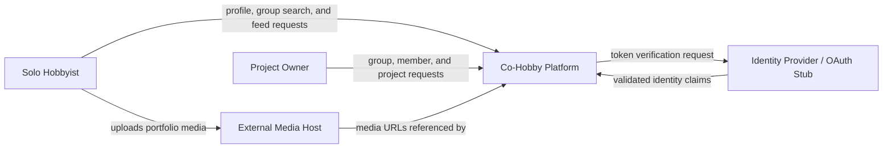

# SENG 321 Revised Assignment — Sprint 1

## Project Information
- **Project Name:** Co-Hobby
- **Team Number:** 19
- **GitHub Repository URL:** <https://github.com/seng321CoHobby/Co-Hobby>
- **OpenAPI Specification File:** [`api/openapi.yaml`](../api/openapi.yaml)
- **Sprint 1 Release Tag:** <https://github.com/seng321CoHobby/Co-Hobby/releases/tag/sprint-1>

## Team Members
| Name | Student Number | GitHub Account | Role | Primary Sprint 1 Ownership |
|---|---|---|---|---|
| Yıldırım Beyazıt Köroğlu | 230201076 | `@beyazitKRGL` | Product Owner | Project Proposal, Scope, Stakeholder Analysis |
| Mete Dugan | 240204029 | `@xa1res` | Scrum Master | Team Roles, RACI Matrix, Git-Flow Governance |
| Enes Alp Erkmen | 240201009 | `@Bruhun` | Architect | System Boundary, OpenAPI Contract Draft |
| Hüseyin Yiğit Özkaya | 240201052 | `@yigitozkaya07` | QA Engineer | Product Backlog, Acceptance Criteria, Peer Review |
| Abdullah Şar | 240201019 | `@sengProje64` | DevOps Engineer | GitHub Rulesets, License, CI Validation |
| Baki Can Erdoğan | 230201052 | `@bakicanerdogan` | Implementation Engineer | System Vision, Domain Schemas, Effort Estimation |

---

## 1 Project proposal

### Problem definition
University students and local hobbyists often use general-purpose social networks, chat groups, or forums to find collaborators. These channels do not provide structured hobby-and-role filtering or clear group vacancies, so users can spend time searching and messaging without knowing whether a group needs their skills. Informal groups may also lose momentum when they have no simple way to track project progress.

### Stakeholder identification and analysis
| Stakeholder | Category | Needs and expectations | Influence or dependence |
|---|---|---|---|
| Solo hobbyists | Primary users | Create skill profiles, search groups by hobby and needed role, and find active teams. | Depend on accurate profiles and vacancies. |
| Group creators / Project Owners | Primary users | Create groups, assign members to vacancies, track milestones, and share finished projects. | Influence membership and project rules. |
| Platform administrators | Operational stakeholders | Use predefined tags in the first release; moderation tools are deferred. | Low first-release dependency. |
| Course evaluators | Sponsors and governance | Assess scope consistency, engineering evidence, and team workflow. | Authority over sprint assessment. |
| Identity and media providers | External dependencies | Supply identity claims and host portfolio media. | Constrain external interfaces. |

### Intended outcome
A registered hobbyist should be able to filter open groups by category and needed role and be added to a compatible group in **less than three minutes** during a usability test. Project Owners should then be able to track sequential milestones (`PLANNING`, `WEEK_1`, `WEEK_2`, `COMPLETED`) and publish completed projects through one workflow.

### Feasibility assessment
- **Technical:** The team plans a Spring Boot REST backend and a web frontend using the OpenAPI contract. Portfolio media remains on external hosts, so the first release stores URLs rather than processing media files.
- **Schedule:** The first release is limited to profiles, group formation, milestones, and project sharing. Chat, swipes, payments, notifications, and administration tools are deferred.
- **Operational and legal:** Write operations require authenticated users, no financial or medical data is processed, and original project code will use the MIT License.

### First release scope

Included:
- Predefined hobby categories and skill roles;
- Hobbyist profiles with biographies, skill roles, and external media URLs;
- Group creation with open roles and group search by category and role;
- Owner-controlled member assignment to a specific open role;
- Group projects with sequential milestone tracking;
- Completed-project sharing and a public project feed.

Deferred:
- Real-time chat, swipe-based matching, voice calls, and video calls;
- Payments, selling services, and advertising;
- Automated email/push notifications and live GPS tracking;
- Administration/moderation panels and raw media hosting;
- Implementation of an identity provider.

### Assumptions and risks
| Type | Statement | Validation or response |
|---|---|---|
| Assumption | Users provide accurate profile and skill information. | Use required fields and predefined hobby/role tags. |
| Assumption | Owners and hobbyists coordinate initial join interest before an owner adds a member. | Check this workflow during peer review; consider join requests in a later release. |
| Assumption | Users can provide external URLs for portfolio media. | Check URI formats and test with sample URLs. |
| Risk | A user may be added twice or assigned to an already filled role. | Return `409 Conflict` and test duplicate/full-vacancy cases. |
| Risk | An owner may skip project stages or share an unfinished project. | Enforce sequential transitions and return `409 Conflict`. |
| Risk | The external identity provider may be unavailable during development. | Use a documented local JWT stub with the same API boundary. |

---

## 2 Open-source license decision record

Decision: **MIT License for original project code**

Rationale:
- Permits use, modification, distribution, and commercial or non-commercial reuse;
- Is short, permissive, and suitable for academic and community collaboration;
- Fits the team's goal of building an accessible hobby-collaboration platform.

Follow-up:
- Add the complete MIT text as `LICENSE` in the repository root;
- Inspect direct and transitive dependency licenses;
- Record incompatible or unknown licenses as release risks.

---

## 3 System vision

> For solo hobbyists and group creators who need dependable partner discovery and project follow-through, **Co-Hobby** provides skill profiles, category-and-role group filtering, and milestone-driven project tracking. The first release supports web users and exposes an OpenAPI contract for implementation and testing.

---

## 4 System boundary

### Inside software responsibility
- Hobby category and skill role catalogue (`/tags`);
- Hobbyist profiles and portfolio URL references (`/profiles`);
- Group creation, search, and member assignment (`/groups`);
- Project milestones and the public completed-project feed (`/projects`, `/feed/projects`).

### Outside or deferred
- Identity-token issuance by an external provider;
- Raw media hosting by external media services;
- Chat, notifications, payments, swipe matching, and administration panels.

### System context diagram



### Constraints and operational assumptions
- **Interface:** Requests and responses use JSON. Validation and domain errors use `application/problem+json`. Local development uses HTTP; deployed environments require HTTPS.
- **Security:** `GET /tags`, `GET /groups`, and `GET /feed/projects` are public. Write operations require a Bearer JWT, and restricted mutations require the group's `OWNER`.
- **Domain:** Stages advance only as `PLANNING → WEEK_1 → WEEK_2 → COMPLETED`; only completed projects can be shared.

---

## 5 Draft OpenAPI contract

The same contract is committed as [`api/openapi.yaml`](../api/openapi.yaml).

```yaml
openapi: 3.1.0
info:
  title: Co-Hobby API
  version: 0.1.0
servers:
  - url: http://localhost:8080/api/v1
security:
  - BearerAuth: []

paths:
  /tags:
    get:
      operationId: getTags
      security: []
      responses:
        '200':
          description: Available hobby categories and roles
          content:
            application/json:
              schema:
                type: array
                items: { $ref: '#/components/schemas/TagCategory' }
              example:
                - category: Music
                  roles: [Guitarist, Drummer, Vocalist]

  /profiles:
    post:
      operationId: createProfile
      requestBody:
        required: true
        content:
          application/json:
            schema: { $ref: '#/components/schemas/NewProfile' }
      responses:
        '201':
          description: Profile created
          content:
            application/json:
              schema: { $ref: '#/components/schemas/ProfileResponse' }
        '400': { $ref: '#/components/responses/BadRequest' }
        '401': { description: Missing or invalid authentication }

  /groups:
    get:
      operationId: listAvailableGroups
      security: []
      parameters:
        - in: query
          name: category
          required: true
          schema: { type: string }
          example: Music
        - in: query
          name: seekingRole
          required: false
          schema: { type: string }
          example: Drummer
      responses:
        '200':
          description: Matching open groups
          content:
            application/json:
              schema:
                type: array
                items: { $ref: '#/components/schemas/GroupListingResponse' }
        '400': { $ref: '#/components/responses/BadRequest' }
    post:
      operationId: createGroup
      description: Creates a group and assigns the creator as OWNER.
      requestBody:
        required: true
        content:
          application/json:
            schema: { $ref: '#/components/schemas/NewGroupListing' }
      responses:
        '201':
          description: Group created
          content:
            application/json:
              schema: { $ref: '#/components/schemas/GroupListingResponse' }
        '400': { $ref: '#/components/responses/BadRequest' }
        '401': { description: Missing or invalid authentication }

  /groups/{groupId}/members:
    post:
      operationId: addGroupMember
      parameters:
        - name: groupId
          in: path
          required: true
          schema: { type: string, format: uuid }
      requestBody:
        required: true
        content:
          application/json:
            schema: { $ref: '#/components/schemas/AddMemberRequest' }
      responses:
        '200':
          description: Member assigned to the requested role
          content:
            application/json:
              schema: { $ref: '#/components/schemas/GroupListingResponse' }
        '400': { $ref: '#/components/responses/BadRequest' }
        '401': { description: Missing or invalid authentication }
        '403': { description: Only the Project Owner can add members }
        '404': { description: Group or user not found }
        '409':
          description: Duplicate member or filled role vacancy
          content:
            application/problem+json:
              schema: { $ref: '#/components/schemas/Problem' }
              example:
                title: Role Vacancy Full
                status: 409
                code: ROLE_SLOT_FULL
                detail: The Drummer vacancy has already been filled.

  /projects:
    post:
      operationId: createProject
      requestBody:
        required: true
        content:
          application/json:
            schema: { $ref: '#/components/schemas/NewProject' }
      responses:
        '201':
          description: Project created in PLANNING stage
          content:
            application/json:
              schema: { $ref: '#/components/schemas/ProjectResponse' }
        '400': { $ref: '#/components/responses/BadRequest' }
        '401': { description: Missing or invalid authentication }
        '403': { description: Only the Project Owner can create a project }
        '404': { description: Group not found }

  /projects/{projectId}/progress:
    patch:
      operationId: updateProjectProgress
      description: Stages advance only as PLANNING to WEEK_1 to WEEK_2 to COMPLETED.
      parameters:
        - name: projectId
          in: path
          required: true
          schema: { type: string, format: uuid }
      requestBody:
        required: true
        content:
          application/json:
            schema: { $ref: '#/components/schemas/ProgressUpdateRequest' }
      responses:
        '200':
          description: Progress updated
          content:
            application/json:
              schema: { $ref: '#/components/schemas/ProjectResponse' }
        '400': { $ref: '#/components/responses/BadRequest' }
        '401': { description: Missing or invalid authentication }
        '403': { description: Subject lacks permission }
        '404': { description: Project not found }
        '409':
          description: Stage skipped or moved backward
          content:
            application/problem+json:
              schema: { $ref: '#/components/schemas/Problem' }

  /projects/{projectId}/share:
    post:
      operationId: shareProject
      parameters:
        - name: projectId
          in: path
          required: true
          schema: { type: string, format: uuid }
      responses:
        '200':
          description: Project shared to the public feed
          content:
            application/json:
              schema: { $ref: '#/components/schemas/ProjectResponse' }
        '401': { description: Missing or invalid authentication }
        '403': { description: Only the Project Owner can share the project }
        '404': { description: Project not found }
        '409':
          description: Project is not COMPLETED
          content:
            application/problem+json:
              schema: { $ref: '#/components/schemas/Problem' }

  /feed/projects:
    get:
      operationId: getSharedProjectsFeed
      security: []
      responses:
        '200':
          description: Shared completed projects
          content:
            application/json:
              schema:
                type: array
                items: { $ref: '#/components/schemas/ProjectResponse' }

components:
  securitySchemes:
    BearerAuth:
      type: http
      scheme: bearer
      bearerFormat: JWT

  schemas:
    TagCategory:
      type: object
      required: [category, roles]
      properties:
        category: { type: string, example: Music }
        roles:
          type: array
          items: { type: string }
          example: [Guitarist, Drummer, Vocalist]

    NewProfile:
      type: object
      required: [displayName, primaryCategory, skillRole]
      properties:
        displayName: { type: string, example: Alex Rivera }
        bio: { type: string, example: Guitarist looking for an indie band. }
        primaryCategory: { type: string, example: Music }
        skillRole: { type: string, example: Guitarist }
        mediaUrls:
          type: array
          items: { type: string, format: uri }
          example: [https://example.com/guitar-demo.mp4]

    ProfileResponse:
      allOf:
        - $ref: '#/components/schemas/NewProfile'
        - type: object
          required: [id, userId]
          properties:
            id: { type: string, format: uuid }
            userId: { type: string, format: uuid }

    NewGroupListing:
      type: object
      required: [groupName, category, creatorSkillRole, neededRoles]
      properties:
        groupName: { type: string, example: Ankara Indie Collective }
        description: { type: string }
        category: { type: string, example: Music }
        creatorSkillRole: { type: string, example: Guitarist }
        neededRoles:
          type: array
          minItems: 1
          items: { type: string }
          example: [Drummer, Vocalist]

    GroupMember:
      type: object
      required: [userId, memberRole, skillRole]
      properties:
        userId: { type: string, format: uuid }
        memberRole:
          type: string
          enum: [OWNER, MEMBER]
        skillRole: { type: string, example: Drummer }

    AddMemberRequest:
      type: object
      required: [userId, skillRole]
      properties:
        userId: { type: string, format: uuid }
        skillRole: { type: string, example: Drummer }

    GroupListingResponse:
      allOf:
        - $ref: '#/components/schemas/NewGroupListing'
        - type: object
          required: [id, members]
          properties:
            id: { type: string, format: uuid }
            members:
              type: array
              items: { $ref: '#/components/schemas/GroupMember' }

    NewProject:
      type: object
      required: [groupId, title]
      properties:
        groupId: { type: string, format: uuid }
        title: { type: string, example: First EP Recording }
        description: { type: string }

    ProgressUpdateRequest:
      type: object
      required: [progressStage]
      properties:
        progressStage:
          type: string
          enum: [PLANNING, WEEK_1, WEEK_2, COMPLETED]
          example: WEEK_1

    ProjectResponse:
      allOf:
        - $ref: '#/components/schemas/NewProject'
        - type: object
          required: [id, progressStage, isShared]
          properties:
            id: { type: string, format: uuid }
            progressStage:
              type: string
              enum: [PLANNING, WEEK_1, WEEK_2, COMPLETED]
            isShared: { type: boolean }

    Problem:
      type: object
      required: [title, status, code]
      properties:
        title: { type: string }
        status: { type: integer }
        code: { type: string }
        detail: { type: string }

  responses:
    BadRequest:
      description: Invalid request parameters or payload
      content:
        application/problem+json:
          schema: { $ref: '#/components/schemas/Problem' }
          example:
            title: Invalid Request
            status: 400
            code: INVALID_INPUT
            detail: Required field skillRole is missing.
```

### Contract review
- The document is valid OpenAPI 3.1.0 and uses consistent resource names.
- Request and response schemas identify required fields and UUID/URI formats.
- Schema examples, a successful tag response, and representative `400`/`409` error bodies are included.
- Path-based operations include `404` responses for missing resources.
- `US-01` maps to `getTags` and `createProfile`; `US-02` to `createGroup`; `US-03` to `listAvailableGroups`; `US-04` to `addGroupMember`; `US-05` to `createProject`; `US-06` to `updateProjectProgress`; and `US-07` to `shareProject` and `getSharedProjectsFeed`.

---

## 6 Team Roles and RACI Matrix

| Activity | Product Owner | Scrum Master | Architect | QA Engineer | DevOps Engineer | Implementation Engineer |
|---|---:|---:|---:|---:|---:|---:|
| Approve Project Proposal and Scope | **A** | C | C | C | I | R |
| Select and Record License | C | I | **A** | I | R | I |
| Define System Vision and Boundary | C | I | **A** | C | I | R |
| Draft and Validate OpenAPI Contract | C | I | **A** | R | I | R |
| Establish Team Roles and RACI | C | **A** | C | C | I | I |
| Configure Git-Flow and Repository Rules | I | **A** | C | C | R | R |
| Author Backlog and Acceptance Criteria | **A** | R | C | R | I | R |
| Validate Sprint 1 Evidence and Release | C | R | R | **A** | R | R |

R = Responsible, A = Accountable (one per row), C = Consulted, I = Informed.

---

## 7 Lightweight Git-Flow policy

```text
main
  Assessed and released versions only; sprint submissions receive tags.

develop
  Integrated work intended for the next release.

feature/<issue>-<short-name>
  Short-lived branch for one story, defect, or technical task.

release/<version> and hotfix/<issue>-<short-name>
  Optional branches used only when needed.
```

Repository rules:
1. No direct push to `main` or `develop`.
2. Every change links to an issue: use `Refs #N` on feature PRs into `develop`; use `Closes #N` on the final release PR into `main`.
3. Every PR contains validation or review evidence.
4. At least one teammate reviews and approves each PR.
5. Required checks pass and review conversations are resolved before merge.
6. Every member contributes from an individual GitHub account.

---

## 8 Initial backlog

### Backlog hierarchy
- **Epic 1: Hobbyist Identity**
  - Feature F-1.1: Tags and profiles (`US-01`).
- **Epic 2: Group Formation**
  - Feature F-2.1: Group creation and discovery (`US-02`, `US-03`).
  - Feature F-2.2: Role-based member assignment (`US-04`).
- **Epic 3: Project Execution and Showcase**
  - Feature F-3.1: Project milestones (`US-05`, `US-06`).
  - Feature F-3.2: Completed-project sharing (`US-07`).

### Prioritized user stories
Estimates are in story points (SP).

| Priority | ID | Feature | Story | Acceptance criteria | SP | Dependencies | Owner |
|---:|---|---|---|---|---:|---|---|
| 1 | US-01 | F-1.1 | As a hobbyist, I can view hobby tags and create a profile so that owners can evaluate my skills. | Tags return `200`; valid profile returns `201`; missing fields or invalid URLs return `400`. | 3 | None | `@bakicanerdogan` |
| 2 | US-02 | F-2.1 | As a creator, I can create a group with my skill and open roles so that vacancies are clear. | Valid group returns `201` with creator as `OWNER`; empty roles return `400`. | 3 | US-01 | `@beyazitKRGL` |
| 3 | US-03 | F-2.1 | As a hobbyist, I can search groups by category and role so that I can find a compatible team. | Matching groups or an empty list return `200`; missing category returns `400`. | 3 | US-02 | `@yigitozkaya07` |
| 4 | US-04 | F-2.2 | As a Project Owner, I can add a member to a specific open role so that the vacancy is filled. | Valid addition returns `200` and `MEMBER`; non-owner returns `403`; unknown IDs return `404`; duplicate/full role returns `409`. | 5 | US-02, US-03 | `@Bruhun` |
| 5 | US-05 | F-3.1 | As a Project Owner, I can start a group project so that we can track its progress. | Valid project returns `201` in `PLANNING`; non-owner returns `403`; unknown group returns `404`. | 3 | US-04 | `@sengProje64` |
| 6 | US-06 | F-3.1 | As a Project Owner, I can advance stages sequentially so that progress remains structured. | Next stage returns `200`; skipped/backward stages return `409`; unknown project returns `404`. | 5 | US-05 | `@sengProje64` |
| 7 | US-07 | F-3.2 | As a Project Owner, I can share a completed project so that users can browse it in the public feed. | Sharing and feed return `200`; sharing before `COMPLETED` returns `409`. | 4 | US-06 | `@xa1res` |

### Definition of Ready
- Actor, capability, and user value are explicit;
- Acceptance criteria cover the main success and failure cases;
- Dependencies and API operations are understood;
- The story fits within one sprint;
- Each story has an estimate and an owner.

---

## 9 Sprint 1 peer-review exercise

Another team should be able to answer without oral explanation:

1. **What problem does the system solve?**  
   It helps hobbyists find groups with suitable skill vacancies and helps formed groups track and share projects.
2. **What remains outside the first release?**  
   Chat, swipe matching, calls, payments, notifications, GPS, administration panels, and raw media hosting.
3. **Can a client developer understand the draft API?**  
   Yes; it defines operation IDs, request/response schemas, role fields, authentication, and representative success and error responses.
4. **Who owns each assessed artifact?**  
   Ownership is identified in the Team Members table and RACI matrix.
5. **Which story should implementation start with?**  
   `US-01`, because tags and profiles have no dependencies and support later group formation.

Internal review revision: `skillRole` was separated from `memberRole`, missing-resource responses were added, and compound backlog items were split into seven stories.

---

## 10 Submission Traceability and GitHub Evidence

| Evidence | Reference | Responsible member(s) | Link |
|---|---|---|---|
| Project Proposal Issue | `DOC-01` / Issue #1 | `@beyazitKRGL` | <https://github.com/seng321CoHobby/Co-Hobby/issues/1> |
| Vision and Boundary Issue | `DOC-02` / Issue #2 | `@bakicanerdogan` | <https://github.com/seng321CoHobby/Co-Hobby/issues/2> |
| OpenAPI Issue | `API-01` / Issue #3 | `@Bruhun` | <https://github.com/seng321CoHobby/Co-Hobby/issues/3> |
| Roles and RACI Issue | `DOC-03` / Issue #4 | `@xa1res` | <https://github.com/seng321CoHobby/Co-Hobby/issues/4> |
| Git-Flow, License, and CI Issue | `OPS-01` / Issue #5 | `@sengProje64` | <https://github.com/seng321CoHobby/Co-Hobby/issues/5> |
| Product Backlog Issue | `DOC-04` / Issue #6 | `@yigitozkaya07` | <https://github.com/seng321CoHobby/Co-Hobby/issues/6> |
| Pull Requests | Merged Sprint 1 PRs | All members | <https://github.com/seng321CoHobby/Co-Hobby/pulls?q=is%3Apr+is%3Aclosed> |
| Commits and Contributions | Sprint 1 history | All members | <https://github.com/seng321CoHobby/Co-Hobby/commits/main> |
| Sprint 1 Release | `sprint-1` | `@sengProje64` | <https://github.com/seng321CoHobby/Co-Hobby/releases/tag/sprint-1> |

## References
- OpenAPI Specification: <https://spec.openapis.org/oas/>
- GitHub Rulesets: <https://docs.github.com/en/repositories/configuring-branches-and-merges-in-your-repository/managing-rulesets/about-rulesets>
- GitHub Projects: <https://docs.github.com/en/issues/planning-and-tracking-with-projects>