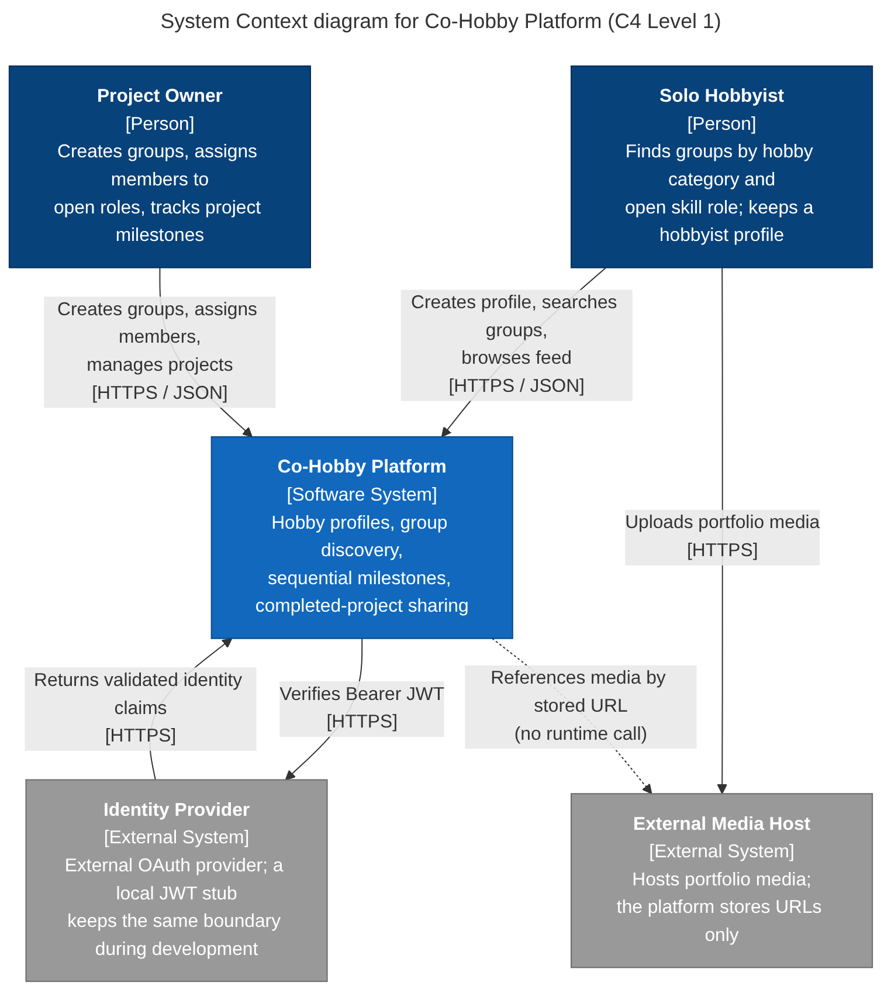
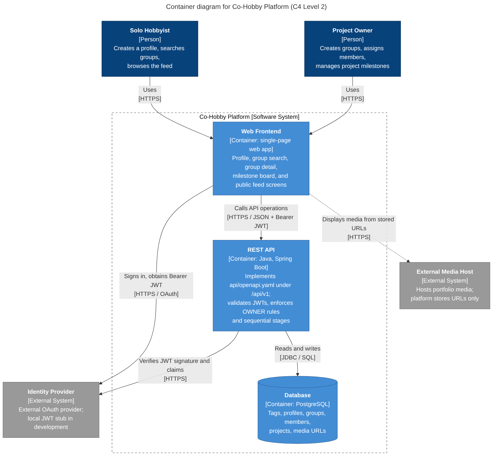

# SENG 321 Sprint 2 Submission — Requirements & Architecture

## Project Information
- **Project Name:** Co-Hobby
- **Team Number:** 19
- **GitHub Repository URL:** <https://github.com/seng321CoHobby/Co-Hobby>
- **Sprint 2 Release Tag:** [`sprint-2`](https://github.com/seng321CoHobby/Co-Hobby/releases/tag/sprint-2) (published from `main` by OPS-04, #37, via release PR [#54](https://github.com/seng321CoHobby/Co-Hobby/pull/54))
- **Figma Project (public, view-only):** <https://www.figma.com/design/SqIaYZLZ0fSslWjnXHuRf8/Co-Hobby-Sprint-2-UI-UX>
- **OpenAPI Specification File:** [`api/openapi.yaml`](../api/openapi.yaml)
- **Assessment Checklist:** [`docs/10-sprint-2-assessment-checklist.md`](10-sprint-2-assessment-checklist.md). No official rubric was shared, so this checklist is the team's reference for Sprint 2.
- **Previous Release:** [`sprint-1`](https://github.com/seng321CoHobby/Co-Hobby/releases/tag/sprint-1)

## Team Members

| Name | Student Number | GitHub Account | Role | Primary Sprint 2 Ownership |
|---|---|---|---|---|
| Yıldırım Beyazıt Köroğlu | 230201076 | [`@beyazitKRGL`](https://github.com/beyazitKRGL) | Product Owner | SRS (#26); product input to the Figma prototypes (#30) |
| Mete Dugan | 240204029 | [`@xa1res`](https://github.com/xa1res) | Scrum Master | Sprint 2 planning and assessment checklist (#24); submission report and contributions (#36) |
| Enes Alp Erkmen | 240201009 | [`@Bruhun`](https://github.com/Bruhun) | Architect | Sprint 2 document skeletons (#38); C4 model and design decisions (#32); UML use-case and state diagrams (#33) |
| Hüseyin Yiğit Özkaya | 240201052 | [`@yigitozkaya07`](https://github.com/yigitozkaya07) | QA Engineer | NFR catalogue (#28); refined backlog and Definition of Done (#27); final QA sweep (#35) |
| Abdullah Şar | 240201019 | [`@sengProje64`](https://github.com/sengProje64) | DevOps Engineer | NFR verification tooling and CI plan (#29); repository cleanup (#25); Sprint 2 release (#37) |
| Baki Can Erdoğan | 230201052 | [`@bakicanerdogan`](https://github.com/bakicanerdogan) | Implementation Engineer | UML class and sequence diagrams (#34); Figma prototypes (#30); user-flow diagrams (#31) |

## Sprint 2 Deliverables at a Glance

| # | Required deliverable | Document | Issue(s) | Pull request(s) |
|---|---|---|---|---|
| 1 | Detailed Software Requirements Specification | [`docs/06-srs.md`](06-srs.md) | [#26](https://github.com/seng321CoHobby/Co-Hobby/issues/26) | [#42](https://github.com/seng321CoHobby/Co-Hobby/pull/42) |
| 1 | Refined Product Backlog | [`docs/05-product-backlog.md`](05-product-backlog.md) | [#27](https://github.com/seng321CoHobby/Co-Hobby/issues/27) | [#44](https://github.com/seng321CoHobby/Co-Hobby/pull/44) |
| 2 | Non-functional requirements and quality measures | [`docs/07-nfr-quality-measures.md`](07-nfr-quality-measures.md) | [#28](https://github.com/seng321CoHobby/Co-Hobby/issues/28), [#29](https://github.com/seng321CoHobby/Co-Hobby/issues/29) | [#43](https://github.com/seng321CoHobby/Co-Hobby/pull/43), [#51](https://github.com/seng321CoHobby/Co-Hobby/pull/51) |
| 3 | Figma UI/UX prototypes | [`docs/09-ui-ux.md`](09-ui-ux.md) §1–§2, [`docs/figma/`](figma/) | [#30](https://github.com/seng321CoHobby/Co-Hobby/issues/30) | [#47](https://github.com/seng321CoHobby/Co-Hobby/pull/47) |
| 3 | User-flow diagrams | [`docs/09-ui-ux.md`](09-ui-ux.md) §3 | [#31](https://github.com/seng321CoHobby/Co-Hobby/issues/31) | [#50](https://github.com/seng321CoHobby/Co-Hobby/pull/50) |
| 4 | C4 models and design decisions | [`docs/08-architecture.md`](08-architecture.md) §2–§4 | [#32](https://github.com/seng321CoHobby/Co-Hobby/issues/32), [#38](https://github.com/seng321CoHobby/Co-Hobby/issues/38) | [#39](https://github.com/seng321CoHobby/Co-Hobby/pull/39), [#45](https://github.com/seng321CoHobby/Co-Hobby/pull/45) |
| 4 | UML diagrams | [`docs/08-architecture.md`](08-architecture.md) §5, [`docs/diagrams/`](diagrams/) | [#33](https://github.com/seng321CoHobby/Co-Hobby/issues/33), [#34](https://github.com/seng321CoHobby/Co-Hobby/issues/34) | [#40](https://github.com/seng321CoHobby/Co-Hobby/pull/40), [#41](https://github.com/seng321CoHobby/Co-Hobby/pull/41), [#46](https://github.com/seng321CoHobby/Co-Hobby/pull/46), [#48](https://github.com/seng321CoHobby/Co-Hobby/pull/48) |

Every Sprint 2 document stays inside the first-release scope from Sprint 1: user stories US-01 to US-07, the system boundary in [`docs/02-vision-and-boundary.md`](02-vision-and-boundary.md), and the API contract in [`api/openapi.yaml`](../api/openapi.yaml). No feature, actor, external system or endpoint was added in Sprint 2.

---

## 1 Software Requirements Specification

**Full document:** [`docs/06-srs.md`](06-srs.md) — authored by `@beyazitKRGL`, reviewed by `@yigitozkaya07` (Issue #26, PR #42).

The SRS turns the Sprint 1 vision, boundary and backlog into requirements that a peer team could implement from:

- **§1 Introduction:** purpose, scope (identical to the Sprint 1 first-release scope), definitions, references and document conventions (`FR-<epic>.<n>` IDs, "shall" statements, use-case structure from the course slides).
- **§2 Overall description:** two user classes (Solo Hobbyist, Project Owner), two external systems (Identity Provider / OAuth stub, External Media Hosts), constraints, assumptions and risks.
- **§3 Functional requirements:** eight requirements (FR-1.1 to FR-3.3), grouped by the three backlog epics, each with a rationale and acceptance criteria.
- **§4 Use cases:** UC-01 Create Profile, UC-02 Create Group, UC-03 Discover Groups, UC-04 Assign Member to an Open Role, UC-05 Advance Milestones and Share Project. Each has actors, preconditions, main flow, alternate/error flows with HTTP status codes, and postconditions.
- **§5 Data requirements:** every entity matches a component schema in `api/openapi.yaml`.
- **§6 Interface requirements:** every endpoint with its operationId, success response and error responses.
- **§8 Requirements traceability matrix** and **§9 UML models** (links to the use-case and state diagrams).

**Requirements traceability (SRS §8):**

| FR | User Story | Use Case | API Operation(s) |
|---|---|---|---|
| FR-1.1, FR-1.2 | US-01 | UC-01 | `getTags`, `createProfile` |
| FR-2.1 | US-02 | UC-02 | `createGroup` |
| FR-2.2 | US-03 | UC-03 | `listAvailableGroups` |
| FR-2.3 | US-04 | UC-04 | `addGroupMember` |
| FR-3.1 | US-05 | UC-05 | `createProject` |
| FR-3.2 | US-06 | UC-05 | `updateProjectProgress` |
| FR-3.3 | US-07 | UC-05 | `shareProject`, `getSharedProjectsFeed` |

## 2 Refined Product Backlog

**Full document:** [`docs/05-product-backlog.md`](05-product-backlog.md) — authored by `@yigitozkaya07`, reviewed by `@beyazitKRGL` (Issue #27, PR #44).

Priorities and estimates were re-validated for Sprint 3 (26 story points in total). The acceptance criteria now cover every SRS error flow (`400`, `401`, `403`, `404`, `409`), using the `application/problem+json` error format from the contract.

| Priority | Story | Summary | SP | Depends on | Sprint 3 owner |
|---:|---|---|---:|---|---|
| 1 | US-01 | View hobby tags and create a profile | 3 | — | `@bakicanerdogan` |
| 2 | US-02 | Create a group with open roles | 3 | US-01 | `@beyazitKRGL` |
| 3 | US-03 | Search groups by category and role | 3 | US-02 | `@yigitozkaya07` |
| 4 | US-04 | Owner adds a member to an open role | 5 | US-02, US-03 | `@Bruhun` |
| 5 | US-05 | Owner starts a group project | 3 | US-04 | `@sengProje64` |
| 6 | US-06 | Owner advances stages sequentially | 5 | US-05 | `@sengProje64` |
| 7 | US-07 | Owner shares a completed project to the public feed | 4 | US-06 | `@xa1res` |

The refined backlog also contains:
- an updated **Definition of Ready**;
- the **Sprint 3 implementation order**, in dependency order from US-01 to US-07;
- a **Definition of Done** for Sprint 3: the implementation matches the contract, success and error paths have tests, JWT and `OWNER` rules are enforced, CI and coverage targets from the NFR document pass, and work arrives through a reviewed PR to `develop`;
- a **scope-control** statement: no new stories, features or endpoints.

## 3 Non-Functional Requirements and Quality Measures

**Full document:** [`docs/07-nfr-quality-measures.md`](07-nfr-quality-measures.md)
- NFR catalogue: authored by `@yigitozkaya07`, reviewed by `@Bruhun` (Issue #28, PR #43).
- Verification tooling and test plans: authored by `@sengProje64`, reviewed by `@yigitozkaya07` (Issue #29, PR #51).

The system is not implemented yet, so every number in the catalogue is a **validation target** for Sprint 3–4, not a claimed result. Each NFR has a measurable criterion, a verification method and a target sprint.

| ID | Attribute | Validation target (summary) | Verification | Sprint |
|---|---|---|---|---|
| NFR-P-01 | Performance | p95 < 300 ms for public reads and < 500 ms for writes at 50 concurrent virtual users, < 1% 5xx | Load test (JMeter or k6) | 4 |
| NFR-P-02 | Performance | LCP ≤ 2.5 s and INP ≤ 200 ms on the group search and feed pages | Lighthouse, DevTools trace | 4 |
| NFR-S-01 | Security | 100% of write endpoints return `401` without a valid JWT; public reads need no token | API integration tests | 3 |
| NFR-S-02 | Security | 100% of `OWNER`-only operations return `403` to non-owners | Role-matrix API tests | 3 |
| NFR-S-03 | Security | Invalid `mediaUrls` return `400`; no raw media is hosted | Contract and Bean Validation tests | 3 |
| NFR-S-04 | Security | HTTPS (TLS 1.2+) when deployed; no payment or medical fields; no committed secrets | Deployment checklist, schema review, secret scanning | 3–4 |
| NFR-U-01 | Usability | A compatible group is found in under three minutes, with ≥ 90% task completion | Moderated usability test (≥ 5 evaluators) | 3–4 |
| NFR-U-02 | Usability | ≥ 90% of participants read category, creator role and open roles correctly on the first try | Usability test with comprehension questions | 4 |
| NFR-R-01 | Reliability | 100% of conflict cases return `409`, with no inconsistent state saved | Transactional API tests, state-machine unit tests | 3 |
| NFR-R-02 | Reliability | `400`/`409` errors follow the `Problem` schema; unknown IDs return `404`; tests pass with the local JWT stub | Contract assertions in CI | 3 |
| NFR-M-01 | Maintainability | The OpenAPI lint passes with 0 errors on every PR that changes the contract | Redocly workflow (already in CI) | 2–4 |
| NFR-M-02 | Maintainability | ≥ 70% line coverage on the core backend; 0 critical lint errors; every PR reviewed and linked to an issue | JaCoCo, Checkstyle/SpotBugs, branch rulesets | 3 |
| NFR-A-01 | Accessibility | Lighthouse accessibility ≥ 90; 0 critical WCAG 2.1 AA violations | Lighthouse, axe DevTools | 4 |
| NFR-A-02 | Accessibility | 100% of primary controls can be used from the keyboard, with a visible focus indicator | Keyboard-only checklist | 4 |

**Verification tooling (§3, PR #51):**
- A verification tool, CI location and evidence artifact for every NFR.
- The Sprint 3 CI plan: build and test, coverage threshold, contract checks, frontend and load-test workflows, and the required status checks.
- The demo-day load-test scenario: 50 concurrent virtual users with a read/write mix.
- A PR quality-gate checklist for later sprints.

## 4 UI/UX Prototypes and User Flows

**Full document:** [`docs/09-ui-ux.md`](09-ui-ux.md)
- Prototypes: authored by `@bakicanerdogan`, product input and review by `@beyazitKRGL` (Issue #30, PR #47).
- User flows: authored by `@bakicanerdogan`, reviewer `@yigitozkaya07` (Issue #31, PR #50).

**Figma file (public, view-only):** <https://www.figma.com/design/SqIaYZLZ0fSslWjnXHuRf8/Co-Hobby-Sprint-2-UI-UX>. The *Screens* page has one frame per screen; the *User Flows* page has one frame per flow. Every screen and flow is also committed as a PNG, so the deliverable can be checked even without the Figma link.

### 4.1 High-fidelity screens

| # | Screen | Story / Use case | API operations | Export |
|---|---|---|---|---|
| 1 | Landing / public project feed | US-07 / UC-05 | `getSharedProjectsFeed` | [`01-feed.png`](figma/01-feed.png) |
| 2 | Profile creation | US-01 / UC-01 | `getTags`, `createProfile` | [`02-profile-creation.png`](figma/02-profile-creation.png) |
| 3 | Group search (category and role filters) | US-03 / UC-03 | `getTags`, `listAvailableGroups` | [`03-group-search.png`](figma/03-group-search.png) |
| 4 | Group detail with open roles | US-03 / UC-03 | `listAvailableGroups` | [`04-group-detail.png`](figma/04-group-detail.png) |
| 5 | Owner member assignment | US-04 / UC-04 | `addGroupMember` | [`05-member-assignment.png`](figma/05-member-assignment.png) |
| 6 | Project milestone board | US-05, US-06 / UC-05 | `createProject`, `updateProjectProgress` | [`06-milestones.png`](figma/06-milestones.png) |
| 7 | Share completed project | US-07 / UC-05 | `shareProject` | [`07-share-project.png`](figma/07-share-project.png) |
| 8 | Group creation form | US-02 / UC-02 | `getTags`, `createGroup` | [`08-create-group.png`](figma/08-create-group.png) |

Each screen shows its success state and its main error or empty states (UI/UX §2.1).

The API contract forced some design decisions (UI/UX §2.2):
- There is no "Join" button, because only the `OWNER` adds members.
- Open roles are derived from `neededRoles` and `members`.
- The milestone board offers only the next stage.

### 4.2 User-flow diagrams

| Flow | Journey | Stories | Export |
|---|---|---|---|
| Flow 1 | Find a group and join (the owner adds the member) | US-01, US-03, US-04 | [`user-flow-find-group.png`](diagrams/user-flow-find-group.png) |
| Flow 2 | Create a group and fill vacancies | US-02, US-04 | [`user-flow-create-group.png`](diagrams/user-flow-create-group.png) |
| Flow 3 | Project milestones and sharing | US-05, US-06, US-07 | [`user-flow-project-share.png`](diagrams/user-flow-project-share.png) |

Every flow marks its decision points and the error branches defined in the contract (`400`, `401`, `403`, `404`, `409`).

## 5 Software Architecture (C4 and UML)

**Full document:** [`docs/08-architecture.md`](08-architecture.md) — C4 and design decisions authored by `@Bruhun`, reviewed by `@bakicanerdogan` (Issues #32 and #38, PRs #39 and #45). Diagram index: [`docs/diagrams/README.md`](diagrams/README.md).

### 5.1 C4 model

Co-Hobby is a **layered monolith**:
- one Spring Boot REST API that implements `api/openapi.yaml` and holds all domain rules;
- a single-page web frontend;
- a PostgreSQL database that only the API can access.

Identity tokens come from an external identity provider; during development, a local JWT stub keeps the same boundary. Portfolio media stays on external hosts, and the platform stores only URLs.

| Level | Diagram | Source | Export |
|---|---|---|---|
| 1 — System Context | People, Co-Hobby, Identity Provider, External Media Host (no new actors since Sprint 1) | [`c4-context.md`](diagrams/c4-context.md) | [`c4-context.png`](diagrams/c4-context.png) |
| 2 — Containers | Web Frontend, REST API (Spring Boot), Database (PostgreSQL) | [`c4-containers.md`](diagrams/c4-containers.md) | [`c4-containers.png`](diagrams/c4-containers.png) |
| 3 — Components | Intentionally omitted (§3.3): the assignment does not name Level 3, and the API layering is covered by DD-01 and the class diagram | — | — |

### 5.2 Design decisions

Each decision records its context, decision, rationale, consequences and the NFRs that drove it (architecture §4).

| ID | Decision | Driving NFRs |
|---|---|---|
| DD-01 | Layered monolith: controllers → services → repositories, in one deployable | NFR-M-02, NFR-P-01 |
| DD-02 | OpenAPI-first contract: `api/openapi.yaml` is the single source of truth | NFR-M-01, NFR-S-03 |
| DD-03 | Authentication boundary: external IdP with a local JWT stub; `OWNER` checks in the service layer | NFR-S-01, NFR-S-02 |
| DD-04 | Relational storage (PostgreSQL) with constraints and ACID transactions | NFR-R-01 |

### 5.3 UML diagrams

| Diagram | Content | Author / Reviewer | Issue / PR | Source | Export |
|---|---|---|---|---|---|
| Use case | 3 actors, 9 use cases tagged with US-01…US-07 and UC-01…UC-05 | `@Bruhun` / `@bakicanerdogan` | #33 / #46 | [`uml-use-case.md`](diagrams/uml-use-case.md) | [`uml-use-case.png`](diagrams/uml-use-case.png) |
| State | Milestone lifecycle PLANNING → WEEK_1 → WEEK_2 → COMPLETED, with `409` transitions and the share guard | `@Bruhun` / `@bakicanerdogan` | #33 / #46 | [`uml-state.md`](diagrams/uml-state.md) | [`uml-state.png`](diagrams/uml-state.png) |
| Class | Domain model matching the OpenAPI component schemas | `@bakicanerdogan` / `@Bruhun` | #34 / #40 | [`uml-class.md`](diagrams/uml-class.md) | [`uml-class.png`](diagrams/uml-class.png) |
| Sequence | `addGroupMember`, with its `403`, `404` and `409` branches | `@bakicanerdogan` / `@Bruhun` | #34 / #40 | [`uml-seq-add-member.md`](diagrams/uml-seq-add-member.md) | [`uml-seq-add-member.png`](diagrams/uml-seq-add-member.png) |
| Sequence | `updateProjectProgress`, with the sequential stage guard | `@bakicanerdogan` / `@Bruhun` | #34 / #40, #41, #48 | [`uml-seq-progress.md`](diagrams/uml-seq-progress.md) | [`uml-seq-progress.png`](diagrams/uml-seq-progress.png) |

## 6 Team Roles and Sprint 2 Responsibilities

Roles are unchanged from Sprint 1 ([`docs/03-roles-and-raci.md`](03-roles-and-raci.md)). Sprint 2 work was split into one issue per artifact. Each issue names one **Responsible** author and one **Reviewer**, plus any **Contributors**.

| Issue | Work item | Responsible | Contributor | Reviewer |
|---|---|---|---|---|
| #24 | PROC-01 Sprint 2 planning and assessment checklist | `@xa1res` | — | `@Bruhun` |
| #25 | OPS-03 Repository cleanup and metadata | `@sengProje64` | `@Bruhun` (repository description and topics) | `@Bruhun` |
| #26 | SRS-01 Software Requirements Specification | `@beyazitKRGL` | `@yigitozkaya07` | `@yigitozkaya07` |
| #27 | DOC-06 Refined backlog and Definition of Done | `@yigitozkaya07` | — | `@beyazitKRGL` |
| #28 | NFR-01 NFR catalogue and quality measures | `@yigitozkaya07` | — | `@Bruhun` |
| #29 | NFR-02 Verification tooling and test plans | `@sengProje64` | — | `@yigitozkaya07` |
| #30 | UX-01 Figma high-fidelity prototypes | `@bakicanerdogan` | `@beyazitKRGL` | `@beyazitKRGL` |
| #31 | UX-02 User-flow diagrams | `@bakicanerdogan` | — | `@yigitozkaya07` |
| #32 | ARCH-01 C4 model and design decisions | `@Bruhun` | `@bakicanerdogan` | `@bakicanerdogan` |
| #33 | ARCH-02 UML use-case and state diagrams | `@Bruhun` | — | `@bakicanerdogan` |
| #34 | ARCH-03 UML class and sequence diagrams | `@bakicanerdogan` | — | `@Bruhun` |
| #35 | QA-01 Final review sweep | `@yigitozkaya07` | — | `@xa1res` |
| #36 | DOC-07 Submission report and contributions | `@xa1res` | `@yigitozkaya07` | `@yigitozkaya07` |
| #37 | OPS-04 Sprint 2 release | `@sengProje64` | — | `@xa1res` |
| #38 | DOC-08 Sprint 2 document skeletons and C4 Level 1 | `@Bruhun` | — | `@bakicanerdogan` |

Per-member evidence (issues, pull requests, reviews, commits) is listed in [`CONTRIBUTIONS.md`](../CONTRIBUTIONS.md#sprint-2--individual-contributions).

## 7 Git-Flow Workflow in Sprint 2

The Sprint 1 policy ([`docs/04-git-flow-policy.md`](04-git-flow-policy.md)) was applied to every Sprint 2 change:

- **Branches:** each issue was developed on `feature/<ID>-<short-name>` from `develop`, for example `feature/SRS-01-srs` and `feature/ARCH-01-c4`.
- **Pull requests:** every PR targets `develop`, references its issue (`Refs #N`), carries the `sprint-2` label plus an area label (`srs`, `backlog`, `nfr`, `ui-ux`, `architecture`, `process`, `release`), and is merged only after at least one approval. Direct pushes to `main` and `develop` are blocked by branch rulesets.
- **Review comments led to changes before merge.** Examples:
  - NFR-M-01 and NFR-S-03 were reworded to match the CI workflow and the contract (PR #43).
  - The stale 403 note in the progress sequence diagram was fixed (PR #48).
- **CI:** the Redocly OpenAPI lint (`.github/workflows/validate-openapi.yml`) runs on every PR that changes the contract. The only contract change in Sprint 2, PR #41, passed it.
- **Milestone and labels:** all Sprint 2 issues (#24–#38) belong to the **Sprint 2** milestone (due 2026-11-24).
- **Release:** after the QA sweep, a reviewed release PR merges `develop` into `main`, and the `sprint-2` tag and GitHub Release are published from `main` (#37).
- **History:** no history on `main` or `develop` was rewritten.

## 8 Sprint 2 Peer-Review Exercise

*Placeholder: the answers come from the QA-01 sweep (#35, `@yigitozkaya07`) and are added before the release. The questions come from the assessment checklist (§6).*

Another team should be able to answer these questions from the repository alone, without an oral explanation:

1. **Which functional requirements does each user story produce, and where is each one traced?**
   *Answer pending (#35).* Reference: SRS §3 and §8.
2. **How is each NFR measured, and which tool or test verifies it?**
   *Answer pending (#35).* Reference: NFR §2–§4.
3. **Can a reviewer follow a user journey from a Figma screen to the API operation it calls?**
   *Answer pending (#35).* Reference: UI/UX §2–§3.
4. **Which containers make up the system, and which external systems does the API depend on?**
   *Answer pending (#35).* Reference: architecture §3.
5. **What happens when an owner fills a full vacancy or skips a milestone stage?**
   *Answer pending (#35).* Reference: sequence and state diagrams.
6. **Which story does Sprint 3 start with, and when is a story "done"?**
   *Answer pending (#35).* Reference: backlog, Sprint 3 order and Definition of Done.

**Internal review revisions:** *pending (#35); to list what changed after review.*

## 9 Submission Traceability and GitHub Evidence

| Deliverable / evidence | Issue | Pull request(s) | Responsible | Reviewer | Files | Checklist items |
|---|---|---|---|---|---|---|
| Sprint 2 document skeletons, C4 Level 1 | [#38](https://github.com/seng321CoHobby/Co-Hobby/issues/38) | [#39](https://github.com/seng321CoHobby/Co-Hobby/pull/39) | `@Bruhun` | `@bakicanerdogan` | `docs/06`–`09`, `docs/diagrams/README.md`, `c4-context.*` | D4.1 |
| Assessment checklist | [#24](https://github.com/seng321CoHobby/Co-Hobby/issues/24) | [#49](https://github.com/seng321CoHobby/Co-Hobby/pull/49) | `@xa1res` | `@Bruhun` | `docs/10-sprint-2-assessment-checklist.md` | P5, §7 |
| Software Requirements Specification | [#26](https://github.com/seng321CoHobby/Co-Hobby/issues/26) | [#42](https://github.com/seng321CoHobby/Co-Hobby/pull/42) | `@beyazitKRGL` | `@yigitozkaya07` | `docs/06-srs.md` | D1.1–D1.3 |
| Refined backlog and Definition of Done | [#27](https://github.com/seng321CoHobby/Co-Hobby/issues/27) | [#44](https://github.com/seng321CoHobby/Co-Hobby/pull/44) | `@yigitozkaya07` | `@beyazitKRGL` | `docs/05-product-backlog.md` | D1.4–D1.6 |
| NFR catalogue and quality measures | [#28](https://github.com/seng321CoHobby/Co-Hobby/issues/28) | [#43](https://github.com/seng321CoHobby/Co-Hobby/pull/43) | `@yigitozkaya07` | `@Bruhun` | `docs/07-nfr-quality-measures.md` §1–§2, §4 | D2.1, D2.2, D2.5 |
| NFR verification tooling and test plans | [#29](https://github.com/seng321CoHobby/Co-Hobby/issues/29) | [#51](https://github.com/seng321CoHobby/Co-Hobby/pull/51) | `@sengProje64` | `@yigitozkaya07` | `docs/07-nfr-quality-measures.md` §3 | D2.3, D2.4, D2.6 |
| Figma high-fidelity prototypes | [#30](https://github.com/seng321CoHobby/Co-Hobby/issues/30) | [#47](https://github.com/seng321CoHobby/Co-Hobby/pull/47) | `@bakicanerdogan` | `@beyazitKRGL` | `docs/09-ui-ux.md` §1–§2, `docs/figma/` | D3.1–D3.4 |
| User-flow diagrams | [#31](https://github.com/seng321CoHobby/Co-Hobby/issues/31) | [#50](https://github.com/seng321CoHobby/Co-Hobby/pull/50) | `@bakicanerdogan` | `@yigitozkaya07` | `docs/09-ui-ux.md` §3–§4, `docs/diagrams/user-flow-*.png` | D3.5, D3.6 |
| C4 Level 2 and design decisions | [#32](https://github.com/seng321CoHobby/Co-Hobby/issues/32) | [#45](https://github.com/seng321CoHobby/Co-Hobby/pull/45) | `@Bruhun` | `@bakicanerdogan` | `docs/08-architecture.md` §1–§4, `c4-*.md/png` | D4.1–D4.4 |
| UML use-case and state diagrams | [#33](https://github.com/seng321CoHobby/Co-Hobby/issues/33) | [#46](https://github.com/seng321CoHobby/Co-Hobby/pull/46) | `@Bruhun` | `@bakicanerdogan` | `uml-use-case.*`, `uml-state.*`, architecture §5.1, SRS §9 | D1.3, D4.7, D4.8 |
| UML class and sequence diagrams | [#34](https://github.com/seng321CoHobby/Co-Hobby/issues/34) | [#40](https://github.com/seng321CoHobby/Co-Hobby/pull/40), [#41](https://github.com/seng321CoHobby/Co-Hobby/pull/41), [#48](https://github.com/seng321CoHobby/Co-Hobby/pull/48) | `@bakicanerdogan` (#40, #48), `@Bruhun` (#41, contract wording) | `@Bruhun`, `@bakicanerdogan` | `uml-class.*`, `uml-seq-*.*`, `api/openapi.yaml` | D4.5, D4.6 |
| Repository cleanup and metadata | [#25](https://github.com/seng321CoHobby/Co-Hobby/issues/25) | [#52](https://github.com/seng321CoHobby/Co-Hobby/pull/52) | `@sengProje64` | `@Bruhun` | root files, `CONTRIBUTIONS.md` | P6, P7 |
| Final QA sweep and peer review | [#35](https://github.com/seng321CoHobby/Co-Hobby/issues/35) | *pending* | `@yigitozkaya07` | `@xa1res` | checklist QA column, §8 of this report | S6, §5 |
| Submission report and contributions | [#36](https://github.com/seng321CoHobby/Co-Hobby/issues/36) | [#53](https://github.com/seng321CoHobby/Co-Hobby/pull/53) | `@xa1res` | `@yigitozkaya07` | this file, `CONTRIBUTIONS.md` | S1, S2, S4, S5 |
| Sprint 2 release | [#37](https://github.com/seng321CoHobby/Co-Hobby/issues/37) | [#54](https://github.com/seng321CoHobby/Co-Hobby/pull/54) | `@sengProje64` | `@xa1res` | [`sprint-2` tag](https://github.com/seng321CoHobby/Co-Hobby/releases/tag/sprint-2), GitHub Release | S3, S7, P8, P9 |
| All Sprint 2 pull requests | Sprint 2 milestone | [Closed PRs](https://github.com/seng321CoHobby/Co-Hobby/pulls?q=is%3Apr+is%3Aclosed) | All members | — | — | P2 |
| Commit history | — | [Commits on `develop`](https://github.com/seng321CoHobby/Co-Hobby/commits/develop) | All members | — | — | P1, P3 |

## References
- Sprint 2 assignment text, SENG 321 Microsoft Teams ("Sprint 2 – Requirements & Architecture").
- Sprint 1 submission: [`docs/seng_321_sprint_1_submission.md`](seng_321_sprint_1_submission.md).
- C4 model: <https://c4model.com/>
- OpenAPI Specification: <https://spec.openapis.org/oas/>
- Mermaid diagram syntax: <https://mermaid.js.org/>
- GitHub Rulesets: <https://docs.github.com/en/repositories/configuring-branches-and-merges-in-your-repository/managing-rulesets/about-rulesets>
